## Objective

- Survey definitions of AI, linking them with biology and academic tribes working on AI over past, present and future.

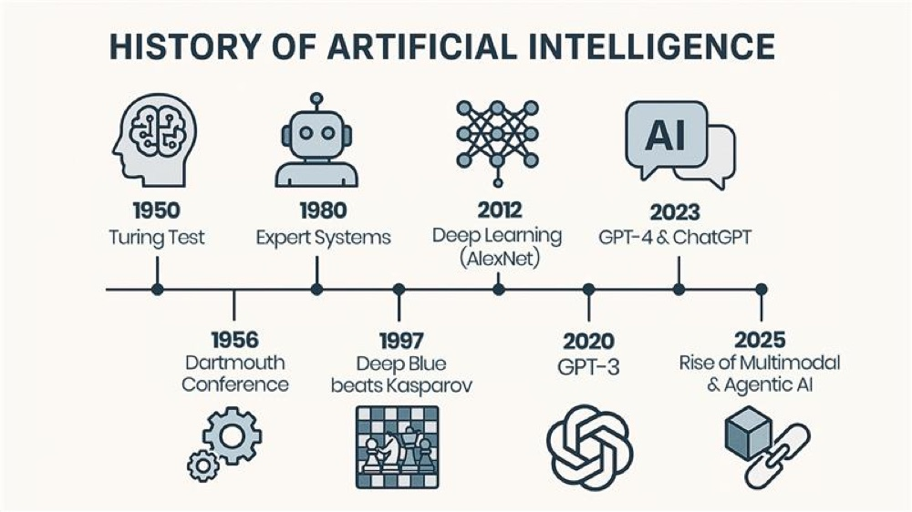

<div style="font-size:0.3em;opacity:.5;line-height:1.2;text-align:center;margin-top:0.3em;">Seventy-five years of moving the goalposts — most of these names recur tonight</div>

---

## Acknowledgements

- **Leonardo Donando**
- **Jonathan Florez Giraldo**
- **Alex Kuznetsov**
- **Delany Adom**
- **Andrei Alain González Galeano**
- **Pedro Domingos** — for *The Master Algorithm* and the five tribes

*With gratitude for their contributions.*

::: {.notes}
Thank these five by name and say a warm sentence about what each contributed before moving on. Keep it brief and heartfelt — a moment of gratitude, not a list to rush through. Double-check the name spellings and pronunciations ahead of time.
:::

---

## Four Threads

- **Intelligence is Task Solving** by learning
- **Minds run on prediction** — animal, human, machine alike
- **"AI" is an Ambiguous Term** — today, a marketing label for LLMs
- **Human intelligence is Sample Efficient Novel Task Solving** — written first in our biology

- Good prediction indicates learning


::: {.notes}
These four threads recur all evening — flag them now so people can track them. Problem-solving by learning is the frame, prediction is the mechanism, "AI" being ambiguous is the caution, and sample-efficient novel problem solving is the yardstick. Tell the audience: whenever I say "intelligence," hold me to that last definition. Point back here each time a thread resurfaces.
:::

---

## Outline

:::: {style="font-size:0.92em;"}
- I Minds: consciousness & animals
- II Human intelligence as machine learning
- III "AI": an ambiguous term
- IV Generative AI & LLMs
- V The five tribes
- VI State of the art
- VII What we want from AGI
- VIII The future
::::

::: {.notes}
Roadmap slide — keep it brief, roughly 20 seconds. Sections I–III build the conceptual frame; IV–VIII are the payoff. Don't read every line aloud; just orient them.
:::

---

## I. Minds: Consciousness & Animals {.section-divider}

## Sentience vs. Sapience

:::: {.columns}
::: {.column width="56%"}
- **Sentience** — to feel, to experience (qualia)
- **Sapience** — to judge, to act with wisdom
- Today's AI mimics sapience, shows no sentience
- That asymmetry is the hard problem
:::
::: {.column width="44%"}
<svg viewBox="0 0 260 230" width="100%" style="max-width:340px" font-family="sans-serif">
  <line x1="42" y1="200" x2="244" y2="200" stroke="#8b919a" stroke-width="1.5"/>
  <line x1="42" y1="200" x2="42" y2="18" stroke="#8b919a" stroke-width="1.5"/>
  <text x="145" y="223" fill="#b9bdc6" font-size="11" text-anchor="middle">Sapience — judgement →</text>
  <text x="16" y="110" fill="#b9bdc6" font-size="11" text-anchor="middle" transform="rotate(-90 16 110)">Sentience — feeling →</text>
  <circle cx="205" cy="46" r="7" fill="#f0a868"/>
  <text x="197" y="40" fill="#e6e6e9" font-size="11" text-anchor="end">Human</text>
  <circle cx="82" cy="66" r="7" fill="#63b3a6"/>
  <text x="94" y="62" fill="#e6e6e9" font-size="11">Animal</text>
  <circle cx="208" cy="186" r="7" fill="#e06c75"/>
  <text x="200" y="178" fill="#e6e6e9" font-size="11" text-anchor="end">Today's AI</text>
</svg>
:::
::::

::: {.notes}
Define the two words carefully — audiences conflate them. Sentience is feeling (qualia), sapience is wise judgement. Chalmers' "hard problem" is why there's subjective experience at all. The asymmetry to stress: our machines are climbing the sapience axis while showing zero evidence on the sentience axis, and we have no test to settle it either way.
:::

---

## Self-Awareness

:::: {.columns}
::: {.column width="52%"}
- Introspection — the self as distinct from the world
- A thinker and a sculpted head: a mind watching itself think
- Not the same as intelligence, nor consciousness
- Perhaps a prerequisite for both
:::
::: {.column width="48%"}
<div style="text-align:center; line-height:1;">

<a href="https://en.wikipedia.org/wiki/Mirror_test" target="_blank" rel="noopener" style="text-decoration:none;">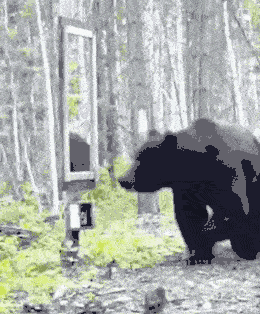</a>
</div>

<div style="text-align:center; line-height:1; margin-top:0.45em;">
<a href="https://en.wikipedia.org/wiki/Mirror_test" target="_blank" rel="noopener" style="text-decoration:none;"></a>
<a href="https://en.wikipedia.org/wiki/Mirror_test" target="_blank" rel="noopener" style="text-decoration:none;"></a>
</div>

<div style="font-size:0.3em;opacity:.55;line-height:1.3;text-align:center;margin-top:0.4em;">A mind watching itself think — and three meeting themselves: bear, infant, child pass the mirror test</div>
:::
::::

::: {.notes}
Use the photograph as the hook — a thinker, and the sculpted head sitting between them and us, a mind watching itself think — then point down to the mirror clips for the flip side: a mind meeting itself. The mirror test is the real experiment here: a bear, a human infant, and an older child, and only some of them work out that the reflection is *them*. Self-recognition is not automatic, it develops, and it is not uniquely human — which is exactly the uncomfortable, useful point. Keep the key distinction crisp: self-awareness, intelligence, and consciousness are three separable things, and we tend to bundle them. "Perhaps a prerequisite" is deliberately hedged — flag it as an open question, not a claim.
:::

---

## A Ladder of Agency


1. Thermostat / bacterium — reactive feedback
2. Dog — bonding, mapping, goals
3. Octopus — distributed cognition, tool use
4. Dolphin — self-recognition, communication
5. Human — metacognition, culture

::: {.notes}
Big caveat first, and say it out loud: this is a teaching device, not a real taxonomy — a ladder implies a single axis, and that's exactly the assumption the animals are about to demolish. Walk up it quickly. The point of building it is to knock it down: intelligence isn't linear, and "higher" is doing a lot of unearned work here.
:::

---

## Primate: Our Closest Relative

:::: {.columns}
::: {.column width="56%"}
- Shared ancestry — chimps, bonobos ~6–7 Mya
- Primate cognition: a rough draft of ours
- The differences are as instructive as the likenesses
:::
::: {.column width="44%"}
[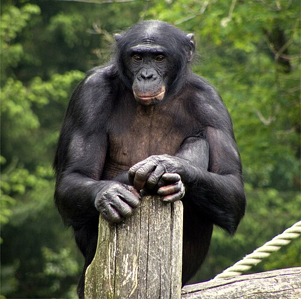{width="100%" style="border-radius:10px;"}](https://en.wikipedia.org/wiki/Bonobo){target="_blank" rel="noopener"}

<span style="font-size:0.34em;opacity:.55;">Bonobo</span>
:::
::::

::: {.notes}
Chimps and bonobos share a common ancestor with us roughly 6–7 million years ago. They give us tool use, coalition politics, and partial theory of mind — a rough draft of our cognition. But lean on the last bullet: what they lack (cumulative culture, language) tells us as much about what makes us us as what they share.
:::

---

## Octopus: Intelligence Reinvented

:::: {.columns}
::: {.column width="56%"}
- Last common ancestor ~550 Mya
- Evolved **completely independently** of ours
- A true natural experiment in cognition
- Similar solutions → convergence is real
:::
::: {.column width="44%"}
<a href="https://en.wikipedia.org/wiki/Cephalopod_intelligence" target="_blank" rel="noopener" style="text-decoration:none;"></a>

<svg viewBox="0 0 260 200" width="100%" style="max-width:330px" font-family="sans-serif">
  <text x="130" y="16" fill="#b9bdc6" font-size="10" text-anchor="middle">~500M neurons</text>
  <!-- arms: hub to 8 ganglia -->
  <g stroke="#f0a868" stroke-width="1.5" opacity="0.7">
    <line x1="130" y1="60" x2="219" y2="92"/>
    <line x1="130" y1="60" x2="203" y2="121"/>
    <line x1="130" y1="60" x2="177" y2="142"/>
    <line x1="130" y1="60" x2="146" y2="153"/>
    <line x1="130" y1="60" x2="114" y2="153"/>
    <line x1="130" y1="60" x2="83" y2="142"/>
    <line x1="130" y1="60" x2="57" y2="121"/>
    <line x1="130" y1="60" x2="41" y2="92"/>
  </g>
  <!-- ring linking adjacent ganglia -->
  <polyline points="219,92 203,121 177,142 146,153 114,153 83,142 57,121 41,92" fill="none" stroke="#63b3a6" stroke-width="1" opacity="0.5" stroke-dasharray="3 3"/>
  <!-- central brain -->
  <circle cx="130" cy="60" r="19" fill="#2b2f36" stroke="#f0a868" stroke-width="2"/>
  <text x="130" y="63" fill="#f0a868" font-size="9" text-anchor="middle">brain</text>
  <!-- arm ganglia -->
  <g fill="#63b3a6">
    <circle cx="219" cy="92" r="6"/><circle cx="203" cy="121" r="6"/>
    <circle cx="177" cy="142" r="6"/><circle cx="146" cy="153" r="6"/>
    <circle cx="114" cy="153" r="6"/><circle cx="83" cy="142" r="6"/>
    <circle cx="57" cy="121" r="6"/><circle cx="41" cy="92" r="6"/>
  </g>
  <text x="130" y="185" fill="#e6e6e9" font-size="10" text-anchor="middle">~2/3 of neurons live in the arms</text>
</svg>
:::
::::

::: {.notes}
This is the star witness. ~550 million years of separate evolution, and yet the octopus independently arrived at tool use, problem solving, and even play. Most of its neurons are in its arms — cognition is distributed, not centralized. The lesson for AI: intelligence is convergent and substrate-independent. Nature built it twice, on totally different architectures, so there's no reason to think our neural nets are the only route.
:::

---

## Messi: Football Intelligence

:::: {.columns}
::: {.column style="width:60%; font-size:0.76em;"}
- Growth-hormone deficiency as a child — physical limits may have driven *compensatory* perception
- Reads play patterns before they unfold — anticipation over speed
- Like chess intuition: pattern recognition, not raw calculation
- A human specialization of the same predictive engine
- *Caveat: the hormone–cognition link is a popular theory, not proven*
:::
::: {.column width="40%"}
<a href="https://en.wikipedia.org/wiki/Lionel_Messi" target="_blank" rel="noopener" style="text-decoration:none;">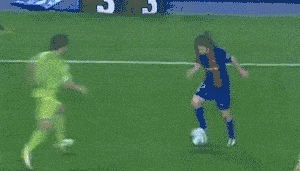</a>

<div style="font-size:0.3em;opacity:.55;line-height:1.3;text-align:center;margin-top:0.3em;">Getafe, 2007 — the pattern, read early</div>
:::
::::

::: {.notes}
A crowd-pleaser — use it to make prediction concrete and human. Let the clip loop and talk over it: Getafe, 2007, the goal everyone calls his best. Watch what he is actually doing — he is not outrunning them, he is arriving where the defenders are about to be. Every one of them is reacting to the present; he is playing the next half-second. That is prediction, wearing a shirt. Same move as a chess master seeing patterns rather than calculating every branch. That's the predictive engine from the spine, specialized. Read the caveat aloud — the growth-hormone-to-genius story is a nice narrative, not established science, and being honest about that models the intellectual care I'm asking of them.
:::

---

## Northoff: Intrinsic Timescales as Priors

:::: {.columns}
::: {.column style="width:46%; font-size:0.8em;"}
- **Georg Northoff** (uOttawa): the brain has **intrinsic neural timescales**
- Sensory cortex integrates **fast**; association cortex **slow**
- Timescales **feed into each other** — a nested hierarchy
- Slow scales act as **priors** for fast ones
- Friston's loop, **built into the wiring**
:::
::: {.column width="54%"}
<svg viewBox="0 0 280 200" width="100%" style="max-width:380px;border-radius:10px;background:#1c1c1c;display:block;margin:0 auto;" font-family="sans-serif" role="img" aria-label="Three stacked cortical layers with increasing intrinsic timescales: sensory cortex tens of milliseconds at the bottom, association cortex hundreds of milliseconds in the middle, prefrontal and default-mode regions seconds at the top. Teal arrows carry sensory evidence upward; blue arrows carry slow priors downward.">
<defs>
<marker id="nt-up" markerWidth="8" markerHeight="8" refX="6" refY="3" orient="auto"><path d="M0,0 L6,3 L0,6 Z" fill="#63b3a6"/></marker>
<marker id="nt-dn" markerWidth="8" markerHeight="8" refX="6" refY="3" orient="auto"><path d="M0,0 L6,3 L0,6 Z" fill="#7aa0e0"/></marker>
</defs>
<rect x="30" y="14" width="200" height="40" rx="6" fill="#2b2f36" stroke="#f0a868"/>
<text x="130" y="31" fill="#f0a868" font-size="11" text-anchor="middle">Prefrontal / default-mode</text>
<text x="130" y="46" fill="#b9bdc6" font-size="9" text-anchor="middle">seconds · slow window</text>
<rect x="60" y="76" width="140" height="40" rx="6" fill="#2b2f36" stroke="#f0a868"/>
<text x="130" y="93" fill="#f0a868" font-size="11" text-anchor="middle">Association cortex</text>
<text x="130" y="108" fill="#b9bdc6" font-size="9" text-anchor="middle">~100s of ms</text>
<rect x="90" y="138" width="80" height="40" rx="6" fill="#2b2f36" stroke="#f0a868"/>
<text x="130" y="155" fill="#f0a868" font-size="11" text-anchor="middle">Sensory cortex</text>
<text x="130" y="170" fill="#b9bdc6" font-size="9" text-anchor="middle">~10s of ms</text>
<line x1="112" y1="136" x2="112" y2="120" stroke="#63b3a6" stroke-width="1.6" marker-end="url(#nt-up)"/>
<line x1="112" y1="74" x2="112" y2="58" stroke="#63b3a6" stroke-width="1.6" marker-end="url(#nt-up)"/>
<line x1="148" y1="58" x2="148" y2="74" stroke="#7aa0e0" stroke-width="1.6" marker-end="url(#nt-dn)"/>
<line x1="148" y1="120" x2="148" y2="136" stroke="#7aa0e0" stroke-width="1.6" marker-end="url(#nt-dn)"/>
<text x="238" y="100" fill="#7aa0e0" font-size="9" text-anchor="start">priors ↓</text>
<text x="238" y="112" fill="#63b3a6" font-size="9" text-anchor="start">evidence ↑</text>
<text x="140" y="194" fill="#8b919a" font-size="8" text-anchor="middle">schematic — timescales are relative, not fixed values</text>
</svg>
:::
::::

::: {.notes}
This sits just before Friston on purpose: it gives the audience a physical picture of what a "prior" might be in tissue, so the Bayes slide lands as a description of something the brain already does. Say the name correctly — Georg Northoff, Canada Research Chair in mind, brain imaging and neuroethics at the University of Ottawa.

The core idea: every region has its own intrinsic timescale, meaning how long its activity stays correlated with itself — how long it holds on to its past. Sensory areas forget in tens of milliseconds, which suits rapidly changing input. Association and prefrontal areas hold on for seconds. Measure it with the autocorrelation window of the resting signal; Murray and colleagues showed the hierarchy in 2014, and Northoff's group has pushed it into a theory of how the brain handles time and input, the temporo-spatial theory of consciousness.

Then make the Friston link, and hedge it: this is my reading, not a settled result. A slow region changes little while a fast region updates constantly, so the slow one is effectively a standing expectation that the fast one is read against — a prior. Evidence flows up, priors flow down, and each timescale feeds the next. Say plainly that the timescales are relative and vary with state and task; the diagram is a schematic, not a measurement.

The one line: the brain doesn't just hold priors, it is built from them — different clocks, nested, each predicting the one beneath it.
:::

---

## Friston: Prediction Under Uncertainty

:::: {.columns}
::: {.column style="width:46%; font-size:0.9em;"}
- The brain predicts the world, not just records it
- Free Energy Principle: minimize surprise
- Consciousness as ongoing active inference
:::
::: {.column width="54%"}
<a href="https://en.wikipedia.org/wiki/Karl_J._Friston" target="_blank" rel="noopener" style="text-decoration:none;"></a>

<svg viewBox="0 0 280 178" width="100%" style="max-width:355px" font-family="sans-serif">
<defs>
<marker id="bay" markerWidth="8" markerHeight="8" refX="6" refY="3" orient="auto">
<path d="M0,0 L6,3 L0,6 Z" fill="#9aa0aa"/>
</marker>
</defs>
<text x="51" y="16" fill="#7aa0e0" font-size="9.5" text-anchor="middle">prior</text>
<rect x="8" y="22" width="86" height="58" rx="6" fill="#2b2f36" stroke="#7aa0e0"/>
<path d="M14,72 C30,72 28,48 51,48 C74,48 72,72 88,72" fill="none" stroke="#7aa0e0" stroke-width="1.6"/>
<line x1="96" y1="51" x2="122" y2="51" stroke="#9aa0aa" stroke-width="1.4" marker-end="url(#bay)"/>
<text x="140" y="16" fill="#63b3a6" font-size="9" text-anchor="middle">likelihood</text>
<circle cx="140" cy="51" r="14" fill="#2b2f36" stroke="#63b3a6"/>
<text x="140" y="56" fill="#63b3a6" font-size="13" text-anchor="middle">×</text>
<line x1="140" y1="94" x2="140" y2="68" stroke="#63b3a6" stroke-width="1.4" marker-end="url(#bay)"/>
<text x="140" y="106" fill="#b9bdc6" font-size="8.5" text-anchor="middle">sense data</text>
<line x1="156" y1="51" x2="184" y2="51" stroke="#9aa0aa" stroke-width="1.4" marker-end="url(#bay)"/>
<text x="231" y="16" fill="#f0a868" font-size="9.5" text-anchor="middle">posterior</text>
<rect x="188" y="22" width="86" height="58" rx="6" fill="#2b2f36" stroke="#f0a868"/>
<path d="M194,72 L212,72 C222,72 224,36 231,36 C238,36 240,72 250,72 L268,72" fill="none" stroke="#f0a868" stroke-width="1.6"/>
<path d="M231,80 L231,142 L51,142 L51,84" fill="none" stroke="#9aa0aa" stroke-width="1.3" stroke-dasharray="4 3" marker-end="url(#bay)"/>
<text x="141" y="156" fill="#b9bdc6" font-size="8.5" text-anchor="middle">becomes the next prior · t → t+1</text>
<text x="141" y="170" fill="#8b919a" font-size="8" text-anchor="middle">belief sharpens as evidence accumulates</text>
</svg>
:::
::::

:::: {style="font-size:0.6em; margin-top:0.1em;"}
$$\underset{\color{#f0a868}{\textbf{posterior}}}{\color{#f0a868}{P(\text{world} \mid \text{sense})}} \;\;\propto\;\; \underset{\color{#63b3a6}{\textbf{likelihood}}}{\color{#63b3a6}{P(\text{sense} \mid \text{world})}} \;\;\cdot\;\; \underset{\color{#7aa0e0}{\textbf{prior}}}{\color{#7aa0e0}{P(\text{world})}}$$
::::

::: {.notes}
This closes Section I and is the keystone for the whole talk. Friston's Free Energy Principle: the brain is not a passive recorder, it's a prediction machine constantly minimizing surprise between what it expects and what it senses. Don't derive the equation — just name it as Bayes' rule: the posterior belief about the world is the prior updated by sensory evidence. Plant the flag here: prediction is the common thread from cortex to transformer, and I'll cash this out in Section IV, with the transformer.

Walk the loop once, left to right, and let the colours do the work — they match the equation underneath. Start with a prior: a broad, uncommitted belief about the world. Multiply by the likelihood, which is what the senses say. Out comes a posterior: the same belief, sharper. Then the move that matters, the dashed arrow: that posterior *becomes the next prior*, and the loop runs again. Note the two curves are the same claim drawn twice — the prior is a fat bump, the posterior a narrow spike. Perception isn't a snapshot; it's this loop, running continuously, all the way down.

If someone asks why "free energy" rather than just Bayes: free energy is the quantity you minimise to make this loop tractable when the exact posterior is out of reach. Say that, then stop — the maths past that point is a lecture of its own.
:::

---

## II. Human Intelligence as Machine Learning {.section-divider}

---

## Why Intelligence Evolved

:::: {.columns}
::: {.column style="width:56%; font-size:0.8em;"}
- **An unstable niche** — the world kept moving
- Two bets: **brittle instinct** or **costly inference**
- We paid to **learn within a lifetime**
- **Tools are the evidence** of that inference
- Three capacities: **world-modelling, transmission, practice**
:::
::: {.column width="44%"}
<a href="https://en.wikipedia.org/wiki/Early_human_migrations" target="_blank" rel="noopener" style="text-decoration:none;">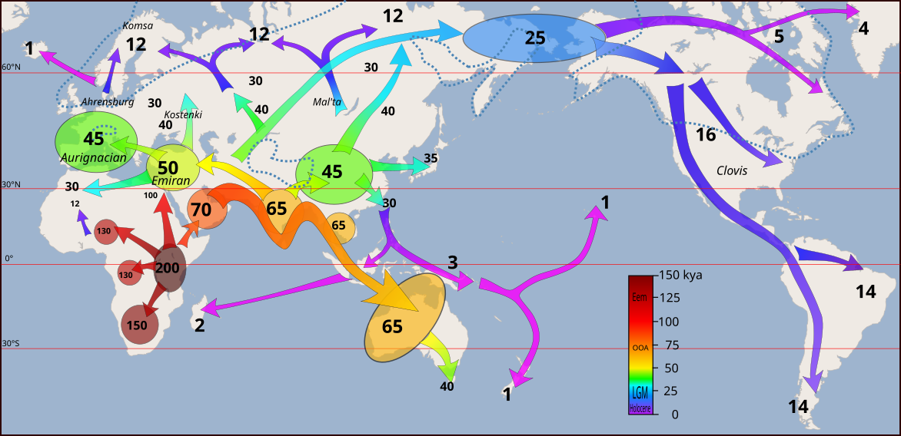</a>

<div style="text-align:center; line-height:1; margin-top:0.5em;">
<a href="https://en.wikipedia.org/wiki/Acheulean" target="_blank" rel="noopener" style="text-decoration:none;">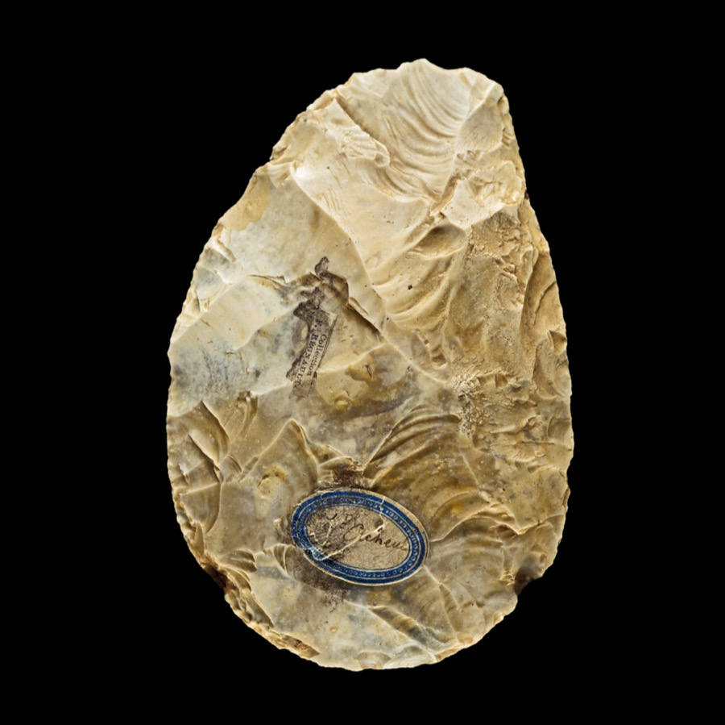</a>
</div>

<div style="font-size:0.3em;opacity:.55;line-height:1.3;text-align:center;margin-top:0.4em;">Out of Africa into everything — and the handaxe that went with us, barely changed for 300,000 years</div>
:::
::::

::: {.notes}
This slide answers the question Section II otherwise skips: why did *this* kind of mind evolve at all? Open with the trade-off and land the one line — instinct is a bet that tomorrow looks like today, and for us it didn't. Terrain, climate, food supply and social arrangement all moved faster than genomes could track, so the cheap compiled answer kept going stale.

Point at the map for what that bet cost us: the same animal ends up in the Arctic and the Kalahari with no specialised instinct for either, paying for a big brain and a childhood far longer than any other ape's. Then the handaxe — this is the slide's best moment, so slow down. Making one means modelling a cause you cannot see, separating means from ends, planning for a need that hasn't arrived, and carrying a technique onto unfamiliar material. Those are exactly the operations a novel problem demands, which is why a worked lump of flint counts as evidence of a mind. Say plainly that this is the standard adaptive account, not a settled one — same hedge as the Messi story.

Close by naming the three capacities and telling them to hold onto the names: world-modelling, transmission, practice. Self-supervised, supervised and reinforcement learning are their machine analogues a few slides from here, and I'll call back to this list at the Unifying View.
:::

---

## Humans: Data-Processing Machines

:::: {.columns}
::: {.column style="width:36%; font-size:0.72em;"}
- **Sensors in, model out** — every sense is a **transducer**
- Not five senses: **five classic, ~nine measured**
- Each stream is a **tensor over time**: sight ≈ H×W×C×T
- Cortex **stacks, convolves, attends** — layers of tensor ops
- Bandwidth in: **~10⁹ bits/s**
- The brain **compresses and predicts**
:::
::: {.column width="40%"}
<svg viewBox="0 0 420 300" style="width:100%;border-radius:10px;background:#1c1c1c;display:block;" role="img" aria-label="Nine human senses as sensor chips, each labelled with its tensor shape: five classic senses highlighted in orange (sight, hearing, touch, taste, smell) and four additional ones (balance, body position, temperature and pain, internal state) in grey, all feeding a brain box.">
  <g font-family="sans-serif" font-size="13" text-anchor="middle">
    <g fill="none" stroke="#f0a868" stroke-width="1.5">
      <rect x="10" y="12" width="120" height="44" rx="8"/><rect x="150" y="12" width="120" height="44" rx="8"/><rect x="290" y="12" width="120" height="44" rx="8"/>
      <rect x="80" y="68" width="120" height="44" rx="8"/><rect x="220" y="68" width="120" height="44" rx="8"/>
    </g>
    <g fill="#f0a868">
      <text x="70" y="32">Sight</text><text x="210" y="32">Hearing</text><text x="350" y="32">Touch</text>
      <text x="140" y="88">Taste</text><text x="280" y="88">Smell</text>
    </g>
    <g fill="#f0a868" font-size="10" opacity=".7">
      <text x="70" y="48">H × W × C × T</text><text x="210" y="48">freq × T</text><text x="350" y="48">skin sites × T</text>
      <text x="140" y="104">taste receptors</text><text x="280" y="104">~400 receptor types</text>
    </g>
    <g fill="none" stroke="#888" stroke-width="1.2" stroke-dasharray="4 3">
      <rect x="10" y="124" width="95" height="44" rx="8"/><rect x="113" y="124" width="95" height="44" rx="8"/><rect x="216" y="124" width="95" height="44" rx="8"/><rect x="319" y="124" width="91" height="44" rx="8"/>
    </g>
    <g fill="#aaa" font-size="12">
      <text x="57" y="143">Balance</text><text x="160" y="143">Body position</text><text x="263" y="143">Temp / pain</text><text x="364" y="143">Internal state</text>
    </g>
    <g fill="#888" font-size="10">
      <text x="57" y="158">3-axis × T</text><text x="160" y="158">joints × T</text><text x="263" y="158">sites × T</text><text x="364" y="158">organs × T</text>
    </g>
    <path d="M210 176 V204 M205 198 L210 206 L215 198" stroke="#f0a868" stroke-width="2" fill="none"/>
    <rect x="90" y="210" width="240" height="46" rx="10" fill="#f0a868"/>
    <text x="210" y="230" fill="#1c1c1c" font-size="14" font-weight="bold">Tensors in → latent → prediction</text>
    <text x="210" y="247" fill="#1c1c1c" font-size="11">~10⁹ bits/s in · ~10 bits/s out</text>
    <text x="210" y="283" fill="#888" font-size="10">Orange = classic five · dashed = the rest · T = time</text>
  </g>
</svg>
:::
::: {.column width="24%"}
<a href="https://commons.wikimedia.org/wiki/File:Sensory_Homunculus-en.svg" target="_blank" rel="noopener" style="text-decoration:none;">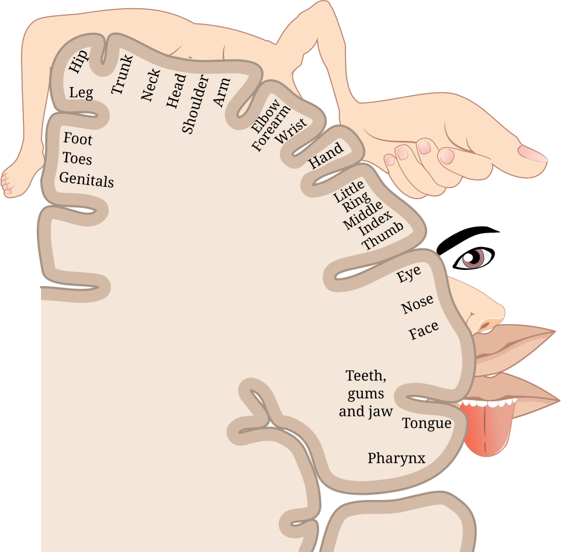</a>

<div style="font-size:0.3em;opacity:.55;line-height:1.3;text-align:center;margin-top:0.4em;">The sensory homunculus — cortex is allocated by data density, not body size</div>
:::
::::

::: {.notes}
This is the "you are already a machine learner" slide — place it right before the properties list so the audience feels the framing before the vocabulary. Open with the question: how many senses do we have? Take a show of hands. Everyone says five; land the correction gently — five is Aristotle's count, and it is a convention, not a measurement.

Give the honest answer: it depends on how you count. Add balance, body position (proprioception), temperature and pain, and internal state (interoception) and you reach about nine; some textbooks list twenty or more by splitting touch and taste into receptor types. So "six" — the usual pop answer, balance or proprioception — is just as arbitrary. Hedge that this is a definitional question, not a settled one.

Then the tensor framing — say this is a modelling lens, not a claim that neurons store arrays. Vision is roughly height × width × colour channels × time (the retina is not a uniform grid, so hedge); hearing is a frequency × time map, much like a spectrogram; touch is a patch of skin sites × time; smell is a vector over roughly 400 receptor types. Every stream is a tensor indexed by time, which is exactly the input format of the models later in the deck, and cortex looks like stacked layers of local filtering (convolution-like) plus attention. The one line: same data type, different substrate.

The point to land: each sense is a transducer turning a physical signal into spikes, and the brain's job is to compress that flood into a model and predict what comes next — this is the Friston slide, and the self-supervised learning slide to come. The bandwidth figures are order-of-magnitude (Zimmermann's sensory estimates, and Zheng and Meister's 2024 "unbearable slowness of being" for ~10 bits/s of behaviour) — say "roughly" and move on. Point at the homunculus for the compute-allocation angle: cortical area tracks sensor density, not body size, so hands, lips and tongue get the lion's share while the back gets almost none — a hardware budget spent where the data is richest. Hedge that the classic drawing is a caricature of a smooth, overlapping map. The one line: a billion bits in, ten bits out, so intelligence is largely the art of throwing the right data away.
:::

---

## Human Intelligence Properties

- Short-Term and Long-Term Memory
- Sample Efficiency — learn from a few examples
- Generalization & Transfer
- Compositionality & Abstraction
- Causal Reasoning, Metacognition, Grounding

::: {.notes}
This list is doing double duty — tell the audience to remember it, because in Section VII I read the exact same list back as the AGI wish-list. Sample efficiency is the one to underline: a child learns "giraffe" from one picture; a model needs thousands. Every item here is a capability our biology already has and our machines mostly don't.
:::

---

## Supervised Learning

:::: {.columns}
::: {.column width="56%"}
- Map inputs → labeled outputs
- Told the answer; adjust to cut error
- Bottleneck: the cost of labels
- Human parallel: a student with an answer key
:::
::: {.column width="44%"}
<canvas class="viz3d" data-scene="descent" role="img" aria-label="Animated 3D error surface with orange balls rolling downhill by gradient descent, leaving trails; a white ring marks the global minimum, so a ball resting elsewhere is stuck in a local valley." style="width:100%;aspect-ratio:5/4;border-radius:8px;background:#1c1c1c;display:block;margin:0 auto;"></canvas>
<div style="font-size:0.3em;opacity:.55;line-height:1.3;text-align:center;margin-top:0.3em;">Error is measured against the labels — each ball is a model sliding down it</div>
:::
::::

::: {.notes}
The most intuitive paradigm, so move briskly. Every training example comes with its correct answer; the model adjusts to shrink the error. The 3D surface is the learning step itself: height is error, each ball is a model, and gradient descent just keeps rolling downhill — the starts are scattered and the surface is bumpy, so balls can settle in different valleys — that is the local-minimum caveat. The white ring marks the true lowest point; any ball resting somewhere else is visibly stuck. Don't promise a particular outcome; whatever you see, say it depends on where you start. Tie it back to supervision: the height is the error against the labels, which is why labels are the bottleneck. The bottleneck is the real teaching point — labels are expensive, they need humans — and that cost is exactly why the field pivoted to the next slide, self-supervision.
:::

---

## Self-Supervised Learning

:::: {.columns}
::: {.column width="56%"}
- Data supplies its own labels — predict the masked word
- The engine behind foundation models
- The internet becomes supervision, unannotated
- Human parallel: an infant learning by observation
:::
::: {.column width="44%"}
<svg viewBox="0 0 260 200" width="100%" style="max-width:340px" font-family="sans-serif">
  <defs>
    <marker id="ar2" markerWidth="8" markerHeight="8" refX="6" refY="3" orient="auto">
      <path d="M0,0 L6,3 L0,6 Z" fill="#9aa0aa"/>
    </marker>
  </defs>
  <text x="14" y="41" fill="#e6e6e9" font-size="11" text-anchor="start">the cat sat on the</text>
  <rect x="113" y="24" width="30" height="24" rx="4" fill="#2b2f36" stroke="#f0a868" stroke-dasharray="3 2"/>
  <text x="128" y="41" fill="#f0a868" font-size="13" text-anchor="middle">?</text>
  <text x="252" y="41" fill="#b9bdc6" font-size="9" text-anchor="end">hide a token</text>
  <line x1="128" y1="52" x2="129" y2="98" stroke="#9aa0aa" stroke-width="1.5" marker-end="url(#ar2)"/>
  <rect x="95" y="102" width="70" height="34" rx="6" fill="#2b2f36" stroke="#f0a868"/>
  <text x="130" y="123" fill="#f0a868" font-size="11" text-anchor="middle">model</text>
  <line x1="130" y1="136" x2="130" y2="158" stroke="#9aa0aa" stroke-width="1.5" marker-end="url(#ar2)"/>
  <rect x="108" y="160" width="44" height="26" rx="5" fill="#2b2f36" stroke="#63b3a6"/>
  <text x="130" y="177" fill="#63b3a6" font-size="12" text-anchor="middle">"mat"</text>
  <text x="235" y="176" fill="#b9bdc6" font-size="9" text-anchor="end">it is the label</text>
</svg>
:::
::::

::: {.notes}
This is the one that unlocked the LLM era, so give it weight. The trick: hide part of the data and make the model predict it — no human labels needed, the data supervises itself. Suddenly the entire internet becomes training signal. Tie it straight back to Friston: predicting the masked word is the same move as the brain predicting its next sensory input. Same principle, silicon substrate.
:::

---

## Unsupervised Learning

:::: {.columns}
::: {.column width="56%"}
- No labels — find structure in the data itself
- Clustering, dimensionality reduction, density estimation
- Reveals hidden groupings and manifolds
- Human parallel: noticing categories no one named
:::
::: {.column width="44%"}
<canvas class="viz3d" data-scene="cluster" role="img" aria-label="Animated 3D point cloud: k-means assigns grey points to three coloured centroids, with thin spokes linking each point to its centroid; the centroids leave trails as they move and settle into the three natural clusters." style="width:100%;aspect-ratio:6/5;border-radius:8px;background:#1c1c1c;display:block;margin:0 auto;"></canvas>
<div style="font-size:0.3em;opacity:.55;line-height:1.3;text-align:center;margin-top:0.3em;">k-means, step by step — assign, then move the centroids. No labels given</div>
:::
::::

::: {.notes}
Keep this short — it's the setup for the "unifying view" two slides on. No labels at all; the algorithm finds structure the data already contains: clusters, low-dimensional manifolds, density. The human parallel is the nice one: noticing categories before anyone gave them names. The 3D scene is real k-means on a synthetic cloud: grey points are unlabelled, each step assigns every point to its nearest centroid — the thin spokes show who owns whom — then moves the centroids to the middle of their points, leaving a short trail, and it settles in a few rounds. It restarts from random centroids, so occasionally it settles differently — that is the algorithm, not a glitch. Don't dwell; the modern action is in self-supervised and RL.
:::

---

## Reinforcement Learning

:::: {.columns}
::: {.column width="56%"}
- Learn from reward and consequence
- Powers game-players and chat-model tuning
- The agent generates its own training signal
- Human parallel: a child learning by trial, reward, and consequence
:::
::: {.column width="44%"}
<canvas class="viz3d" data-scene="gridworld" role="img" aria-label="Animated 3D grid world: an agent learns by Q-learning, leaving an orange trail; tiles rise as value spreads back from the teal goal tile, and white arrows showing the best move on each tile appear as the policy is learned." style="width:100%;aspect-ratio:6/5;border-radius:8px;background:#1c1c1c;display:block;margin:0 auto;"></canvas>
<div style="font-size:0.3em;opacity:.55;line-height:1.3;text-align:center;margin-top:0.3em;">The agent acts, the grid returns state + reward — tiles rise toward the reward</div>
:::
::::

::: {.notes}
No fixed dataset — the agent acts, gets reward or penalty, and generates its own training signal. The 3D grid is real Q-learning: the teal tile is the reward, the red tiles are penalties, and tile height is how valuable the agent currently thinks each square is. Watch the value spread backwards from the goal over the first ten or so seconds; the white arrows are the policy — on each tile, the move the agent now thinks is best — and they appear only once a tile has learned something, so you can watch the plan assemble itself backwards from the reward. The orange trail is the agent's recent wandering. Then the path stabilises; it resets and relearns every forty seconds. This is what beat the world at Go and, more to the point, it's the "RLHF" tuning that turned a raw next-token predictor into a helpful chatbot. Flag the connection: this is the second half of the recipe I'm about to name. A child learning a hot stove is the whole idea in one image.
:::

---

## Unifying View

- Self-supervised prediction builds the world model
- Reinforcement fine-tunes on top
- The same recipe in human brain and in models

::: {.notes}
Section II landing. Compress the whole section to one sentence: self-supervised prediction builds the world model, reinforcement fine-tunes it on top — and that two-stage recipe is how you train a frontier LLM and, plausibly, how the cortex works too. This is the boldest claim of the section, so state it as a claim, not a fact. It sets up Section III's question: if this is all "just" prediction, what do we even mean by "AI"?
:::

---

## III. "AI": An Ambiguous Term {.section-divider}

---


## Beginning: Dartmouth, 1956

:::: {.columns}
::: {.column width="62%"}

- McCarthy chose "artificial intelligence"
- The conjecture: intelligence can be *"so precisely described that a machine can be made to simulate it"*
- They thought a summer and 10 assistants would do it.
:::
::: {.column width="38%"}
<div style="display:flex; flex-direction:column; gap:0.3em; align-items:center;">
<div style="display:flex; gap:0.5em; justify-content:center;">
<figure style="margin:0; text-align:center;">
<a href="https://en.wikipedia.org/wiki/John_McCarthy_(computer_scientist)" target="_blank" rel="noopener" style="text-decoration:none;">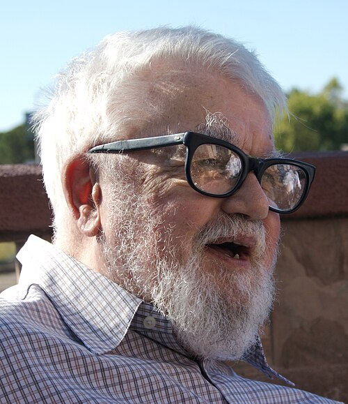</a>
<figcaption style="font-size:0.32em;opacity:.75;margin:0.1em 0 0 0;line-height:1;">McCarthy</figcaption>
</figure>
<figure style="margin:0; text-align:center;">
<a href="https://en.wikipedia.org/wiki/Marvin_Minsky" target="_blank" rel="noopener" style="text-decoration:none;">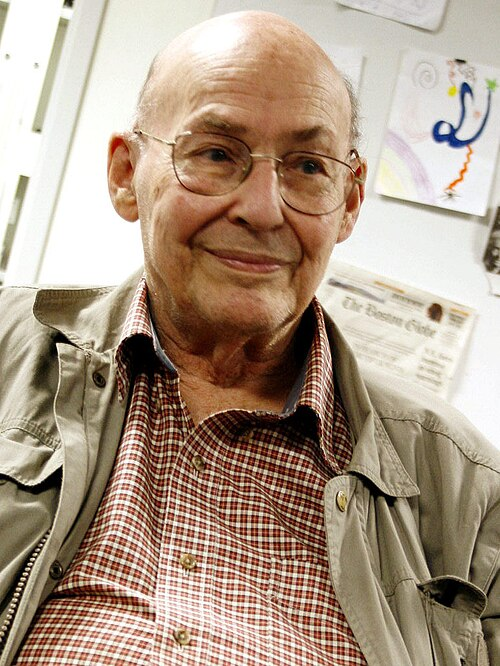</a>
<figcaption style="font-size:0.32em;opacity:.75;margin:0.1em 0 0 0;line-height:1;">Minsky</figcaption>
</figure>
<figure style="margin:0; text-align:center;">
<a href="https://en.wikipedia.org/wiki/Claude_Shannon" target="_blank" rel="noopener" style="text-decoration:none;">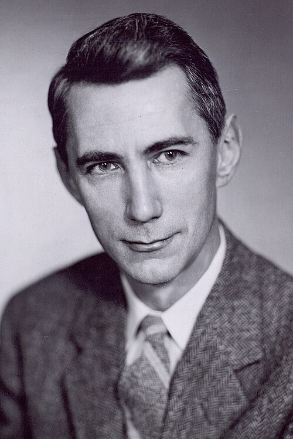</a>
<figcaption style="font-size:0.32em;opacity:.75;margin:0.1em 0 0 0;line-height:1;">Shannon</figcaption>
</figure>
</div>
<div style="font-size:0.3em; opacity:.5; line-height:1.3; text-align:center;">with Nathaniel Rochester — the four<br/>who signed the 1955 proposal</div>
</div>
:::
::::

::: {.notes}
The origin story, and it is evidence for the whole section — so tell it as evidence, not trivia. Summer 1956, Dartmouth College: a six-week workshop proposed the year before by McCarthy, Minsky, Rochester and Shannon. It is conventionally the founding moment of the field.

The detail that matters is the second bullet, and it is the reason this slide exists: McCarthy picked the words "artificial intelligence" because they were *neutral* — he wanted to avoid being annexed by cybernetics and its analog-feedback framing, and he wanted to avoid a fight with Norbert Wiener, who was formidable. So the name of our entire discipline was a political choice made to dodge a rival school and a difficult colleague, before there was any science to name. That is the ambiguity thread with a birth certificate: "AI" was a label first and a field second.

Land the last bullet lightly — about twenty people passed through, daily attendance ran three to eight, and only Solomonoff, Minsky and McCarthy stayed the whole summer. The founding event of the field was a loosely-attended summer workshop, not a moment of revelation.
:::

---

## Four Acronyms

:::: {style="font-size:0.86em;"}
- **ML** — algorithms that improve at a task with more data
- **ANI** — narrow: superhuman at one task, useless outside it
- **AGI** — general: human-level breadth, *novel* tasks included
- **ASI** — beyond: exceeds the best humans at essentially everything
::::

<a href="https://en.wikipedia.org/wiki/Artificial_general_intelligence" target="_blank" rel="noopener" style="text-decoration:none;">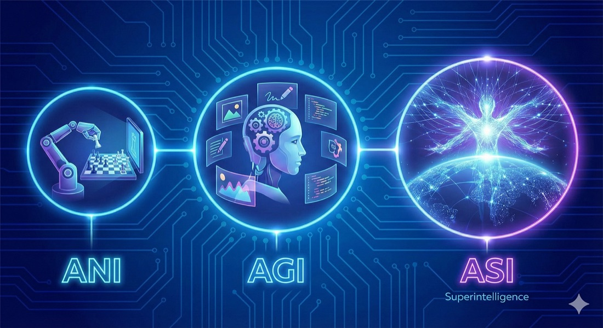</a>

<div style="font-size:0.3em;opacity:.5;line-height:1.2;text-align:center;margin-top:0.25em;">ANI is here · AGI is the aspiration · ASI is the artwork</div>

::: {.notes}
Pause here and pin the vocabulary down — the rest of the talk depends on these four not blurring together. ML is the method: systems that improve from data rather than hand-coded rules; it powers everything on this slide. ANI is what we actually have — chess engines, translators, LLMs: superhuman in a lane, helpless outside it. AGI is the aspiration — human-level breadth, and stress the word *novel*: problems it wasn't trained for. ASI is the speculation beyond that; mention it once, don't let the talk drift into sci-fi. Use the picture against itself for that — notice that ANI gets a robot arm playing chess (a real thing that exists), AGI gets a humanoid juggling tasks (a hope), and ASI gets a glowing cosmic figure rising over the Earth (a painting). The artwork escalates exactly as the evidence evaporates. That is the whole slide's caution in one image, and it lets you make the point with a smile rather than a lecture. The trap to name out loud: "AI" in headlines slides between all four. When someone says AI, ask which one they mean — that's the ambiguity thread again.
:::

---

## Make Coffee

:::: {.columns}
::: {.column width="58%"}
- Functionalist test: a machine does what a human did — intelligent?
- Once we see the mechanism, we stop calling it AI
- Chess, OCR, translation — "AI" until it worked
- Make coffee in any kitchen in the world
- "AI" often means: *not yet understood*
:::
::: {.column width="42%"}
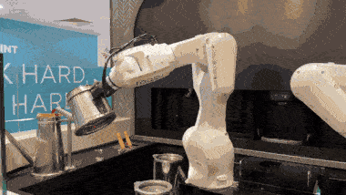

<div style="font-size:0.3em;opacity:.55;line-height:1.3;text-align:center;margin-top:0.3em;">Coffee, yes — but in a rig built for it, not <em>any</em> kitchen</div>
:::
::::

::: {.notes}
This is the "AI effect" and the emotional centre of the section. The pattern: chess, OCR, translation were all "AI" right up until they worked — then we saw the mechanism and demoted them to "just software." "Make coffee in any unfamiliar kitchen" (Wozniak's test) is the vivid version of a task still on the far side of that line. Use the clip against itself: yes, that arm makes coffee — but look where. It is a fixed barista rig built around the machine, every cup and spout in a known spot. That is the easy half of Wozniak's test. The hard half — walking into a stranger's kitchen and finding the beans — is exactly what no robot can do, and the gap between the two is the whole point. Land the punchline: "AI" too often just labels whatever we don't yet understand — a moving goalpost, not a category. This directly teases the thesis slide.
:::

---

## Turing Test

:::: {.columns}
::: {.column width="60%"}
- Imitation: indistinguishable in text → passes
- Says nothing about internal states
- Cited often, engineered against rarely
- A floor, not a ceiling
:::
::: {.column width="40%"}
[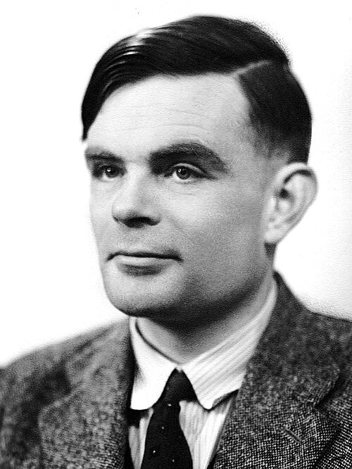{width="78%" style="border-radius:10px;"}](https://en.wikipedia.org/wiki/Alan_Turing){target="_blank" rel="noopener"}
:::
::::

::: {.notes}
Turing sidestepped "can machines think?" by replacing it with a behavioural test: if you can't tell it from a human in text, it passes. Two honest criticisms: it says nothing about internal states (the Chinese Room objection), and it's cited constantly but almost never actually engineered toward. The verdict to voice: a useful floor for the conversation, never a ceiling — and arguably modern chatbots pass it while being nobody's idea of AGI.
:::

---

## Russell & Norvig: Agents

:::: {.columns}
::: {.column width="54%"}
- Act to achieve the best expected outcome
- The textbook definition — agent, environment, measure
- Says nothing about *how* — only that it decides well
:::
::: {.column width="46%"}
<svg viewBox="0 0 270 200" width="100%" style="max-width:350px" font-family="sans-serif">
  <defs>
    <marker id="ar4" markerWidth="8" markerHeight="8" refX="6" refY="3" orient="auto">
      <path d="M0,0 L6,3 L0,6 Z" fill="#9aa0aa"/>
    </marker>
  </defs>
  <rect x="18" y="70" width="86" height="40" rx="8" fill="#2b2f36" stroke="#f0a868" stroke-width="2"/>
  <text x="61" y="95" fill="#f0a868" font-size="12" text-anchor="middle">Agent</text>
  <rect x="166" y="70" width="90" height="40" rx="8" fill="#2b2f36" stroke="#b9bdc6"/>
  <text x="211" y="95" fill="#e6e6e9" font-size="11" text-anchor="middle">Environment</text>
  <path d="M104,82 C135,72 138,72 164,80" fill="none" stroke="#9aa0aa" stroke-width="1.6" marker-end="url(#ar4)"/>
  <text x="134" y="66" fill="#b9bdc6" font-size="10" text-anchor="middle">action</text>
  <path d="M166,100 C138,110 135,110 106,100" fill="none" stroke="#63b3a6" stroke-width="1.6" marker-end="url(#ar4)"/>
  <text x="134" y="124" fill="#63b3a6" font-size="10" text-anchor="middle">percepts</text>
  <rect x="5" y="150" width="112" height="34" rx="8" fill="#2b2f36" stroke="#e0b062" stroke-dasharray="4 3"/>
  <text x="61" y="166" fill="#e0b062" font-size="8" text-anchor="middle">utility /</text>
  <text x="61" y="177" fill="#e0b062" font-size="8" text-anchor="middle">performance measure</text>
  <line x1="61" y1="150" x2="61" y2="112" stroke="#9aa0aa" stroke-width="1.5" marker-end="url(#ar4)"/>
  <text x="128" y="170" fill="#b9bdc6" font-size="9">what it maximizes</text>
</svg>
:::
::::

::: {.notes}
The definition most working engineers actually use — it's the frame of the Russell & Norvig textbook nearly everyone in AI trained on. An agent perceives an environment and acts to maximize an expected performance measure. Its strength is that it's operational and buildable; its silence is deliberate — it says nothing about consciousness or "how," only that the agent decides well. Contrast with Turing: behaviour-plus-goals rather than behavior-mimics-human.
:::

---

## Chollet: Intelligence as Adaptation

:::: {.columns}
::: {.column width="60%"}
- Efficiency at acquiring *new* skills
- Adaptation, not static performance
- The machine echo of human skill acquisition
- Memorize well, adapt poorly → not intelligent
:::
::: {.column width="40%"}
[{width="80%" style="border-radius:10px;"}](https://fchollet.com/){target="_blank" rel="noopener"}
:::
::::

::: {.notes}
Chollet is the counterweight to Sutton, and the definition closest to my own spine. Intelligence isn't static performance — it's skill-acquisition efficiency: how fast you turn a little experience into competence on genuinely new problems. This is where his ARC benchmark comes from, and why LLMs, which memorize spectacularly, took years and enormous compute budgets to crack it — the point was never whether they could, but at what cost in experience. Connect it explicitly back to "sample-efficient novel problem solving" from the opening. Memorize well but adapt poorly, and you're not intelligent.
:::

---

## One Definition of Knowledge

- **Data** — raw, uncompressed
- **Compression** — redundancy found
- **Abstraction** — the reusable structure it yields
- **Prediction** — the test on unseen data
- **Knowledge** — abstraction that keeps passing

Process **data** to generate **knowledge**

::: {.notes}
Walk the pipeline slowly, it's the backbone of the section: raw data, compress out the redundancy, the reusable structure that survives is abstraction, the test is prediction on unseen data, and knowledge is abstraction that keeps passing that test. The key idea, and it echoes Friston: to know something is to compress it well enough to predict. Knowledge is compression that predicts.
:::

---

## Knowledge as Compression

:::: {.columns}
::: {.column style="width:58%; font-size:0.82em;"}
Three traditional sources of knowledge:

- **Genes** — survival encoded by evolution
- **Experience** — direct interaction
- **Culture** — collective wisdom, transmitted

A fourth new source, over the last 50 years:

- **Computers** — synthesis at scale
:::
::: {.column width="42%"}
<canvas class="viz3d" data-scene="roll" role="img" aria-label="Animated 3D scene: points on a faint, colour-graded rolled-up sheet, seen from above; the sheet unrolls into a flat strip facing the viewer, showing that three coordinates per point hide a two-dimensional structure." style="width:100%;aspect-ratio:1/1;border-radius:8px;background:#1c1c1c;display:block;margin:0 auto;"></canvas>
<div style="font-size:0.3em;opacity:.55;line-height:1.3;text-align:center;margin-top:0.3em;">Compression is finding the structure — 3 numbers per point, 2 that matter</div>
:::
::::

::: {.notes}
The 3D scene is the idea in miniature: every point is stored with three coordinates, but they all lie on a rolled-up sheet, so two numbers are enough once you know the roll. Watch it unroll: the camera swings round to face the flat sheet, and the colour — which only tracks how far along the roll a point sits — becomes a clean left-to-right gradient. Finding that sheet is compression, and it is what every learner does; say the roll is a stand-in for any hidden regularity. Four substrates that all run the same compression algorithm on different timescales: genes compress survival over evolutionary time, experience over a lifetime, culture across generations, and computers now do it at planetary scale in months. The through-line: each is prediction encoded into a different medium. Computers are just the newest, fastest substrate for an ancient process — which reframes LLMs as continuous with biology, not alien to it.
:::

---

## IV. Generative AI & LLMs {.section-divider}

---

## What Gen AI Is

:::: {.columns}
::: {.column width="56%"}
- Simulation from a partially learned distribution; produces new samples
- Text, image, audio, code
- Self-supervised pre-training + the transformer
- Planetary scale recursive classification simulation
:::
::: {.column width="44%"}
<figure style="margin:0; text-align:center;">
  <a href="https://en.wikipedia.org/wiki/Diffusion_model" target="_blank" rel="noopener" style="text-decoration:none;">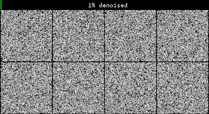</a>
  <figcaption style="font-size:0.3em;opacity:.55;margin:0.2em 0 0 0;line-height:1.3;">Noise → sample: a diffusion model inventing characters</figcaption>
</figure>
:::
::::

::: {.notes}
This opens the payoff half — re-anchor the four spine threads in one breath, then go. Generative AI learns a probability distribution over data and samples new points from it — text, image, audio, code, all the same trick. Two ingredients did it: self-supervised pre-training plus the transformer. The phrase to plant, because it pays off in Section VI, on the System 1 vs. System 2 slide: this is "System 1 at planetary scale" — fast, fluent, intuitive pattern-completion, with no deliberate reasoning behind it yet.

Let it loop while you talk — it is the first bullet happening in front of them. The counter runs from 1% to 99% denoised: the model starts from pure noise and walks it, step by step, into a sample. That is what "simulation from a learned distribution" means, and no equation lands it as fast.

The detail worth pausing on: these are not real Chinese characters. The model learned the *distribution* of characters — strokes, radicals, balance, the way they sit in a square — and drew new ones from it. They look right to anyone who doesn't read Chinese, and wrong to anyone who does. That is generative AI in one image: fluent in the form, indifferent to the meaning. It also pre-loads "What Gen AI Is Not," the next slide — fluency is not knowledge.
:::

---

## What Gen AI Is Not

- No guarantee of truth, cause, or grounding
- Fluency is not knowledge
- It compresses culture and lets us query it
- New and powerful — not a mind

::: {.notes}
The deliberate counterweight to the hype slide before it — keep the tone measured, not dismissive. No guarantee of truth, cause, or grounding; fluency is not knowledge (this is where hallucination lives). The generous framing: it compresses human culture and lets us query it in natural language, which is genuinely new and genuinely powerful. But hold the line — powerful tool, not a mind. Both halves are true at once.
:::

---

## The LLM

:::: {.columns}
::: {.column width="58%"}
- A next-token predictor over human text
- No persistent memory, weak causal models
- Unreliable deliberate reasoning
- A statistical reflection of us
:::
::: {.column width="42%"}
<figure style="margin:0; text-align:center;">
  <a href="https://en.wikipedia.org/wiki/Attention_(machine_learning)" target="_blank" rel="noopener" style="text-decoration:none;">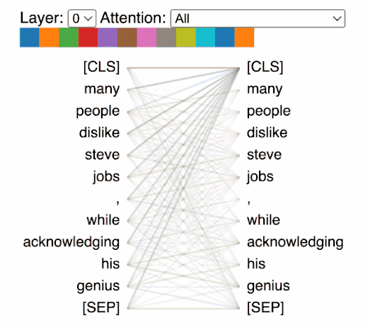</a>
  <figcaption style="font-size:0.3em;opacity:.55;margin:0.2em 0 0 0;line-height:1.3;">Attention, layer by layer — every token weighing every other</figcaption>
</figure>
:::
::::

::: {.notes}
The most precise technical description in the deck — slow down and be exact, some of the audience are specialists. Strip it to the mechanism: an LLM predicts the next token over human text, nothing more. From that fall the real limits — no persistent memory across sessions, weak causal models, unreliable multi-step reasoning. Close on the resonant line: it's a statistical reflection of us, our text mirrored back. That framing sets up the entire "state of the art" gaps section.

Let the animation loop while you talk — it is attention itself, every token weighing every other, layer by layer. Point at the crossing lines and say: that is the entire mechanism. No memory, no plan, no model of the world — weighted lookups over the context window, stacked a few dozen times. Everything the machine knows, it knows by re-reading its own input.

One caveat, and concede it fast if a specialist raises it: this is BertViz, so the tokens are BERT's — [CLS] and [SEP] — and BERT is a *masked* model, not a next-token predictor. The attention mechanism is identical; only the masking differs. If that trade bothers you, the alternative is an architecture diagram, which is more precise and much less alive.
:::


## V. The Five Tribes {.section-divider}

---

## Symbolists — Logic and Deduction

:::: {.columns}
::: {.column style="width:52%; font-size:0.74em;"}
- Roots: logic — Newell & Simon's symbol system hypothesis
- Learning = inverse deduction; rules, trees, expert systems
- Precise and auditable — but brittle
- Optimization: combinatorial search over rule/hypothesis space
- Modern echo: neuro-symbolic AI, formal verification
- EXAMPLE: Routing Email Complaints
:::
::: {.column width="48%"}
<a href="https://en.wikipedia.org/wiki/Decision_tree_learning" target="_blank" rel="noopener" style="text-decoration:none;">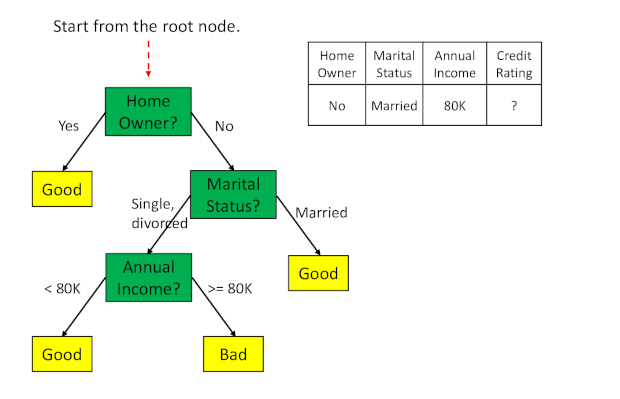</a>

<div style="font-size:0.3em;opacity:.55;line-height:1.3;text-align:center;margin-top:0.25em;">Every answer comes with its own audit trail</div>

<a href="https://web.mit.edu/cocosci/josh.html" target="_blank" rel="noopener" style="text-decoration:none;"></a>

<div style="font-size:0.3em;opacity:.55;line-height:1.2;text-align:center;">Josh Tenenbaum</div>
:::
::::

::: {.notes}
Framing for the whole section — this is Pedro Domingos' "five tribes" from The Master Algorithm. The symbolists came first: intelligence is the manipulation of symbols by explicit rules, and learning is inverse deduction — inferring the rules from examples. Their systems are precise and auditable, which is exactly why they're brittle when reality doesn't fit the rules. The email example: a rule tree that routes complaints by keywords — transparent, but it shatters on a phrasing nobody wrote a rule for. Modern echo: neuro-symbolic AI and formal verification.

Let the tree animation loop and use it for the third bullet — it is the tribe's whole case in one picture. A record walks the tree, and at every node you can see exactly which rule fired and why: home owner, marital status, income, verdict. That is what "auditable" means, and not one neural network in this deck can show you that. Then turn it over in the same breath: the rigidity *is* the brittleness. The tree has no answer for a record it was never given a branch for — it cannot hedge, it cannot guess, it just falls off the end.
:::

---

## Connectionists — Brain Inspired

:::: {.columns}
::: {.column width="66%"}
- Roots: McCulloch–Pitts (1943), Rosenblatt's perceptron (1958)
- Backpropagation (1986) → CNNs → transformers
- Optimization: stochastic gradient descent via backpropagation
- Scales with data and compute — and dominates today
- EXAMPLE: Making DNA viral capsids
:::
::: {.column width="34%"}
<canvas class="viz3d" data-scene="network" role="img" aria-label="Animated 3D neural network running a forward pass: each pulse feeds a new input through four layers, orange edges excite, blue edges inhibit, and the winning output unit flares." style="width:100%;aspect-ratio:4/3;border-radius:8px;background:#1c1c1c;display:block;margin:0 auto;"></canvas>

<div style="font-size:0.28em;opacity:.55;line-height:1.2;text-align:center;margin-bottom:0.4em;">Signals flowing forward, layer by layer — the 1943 cartoon, stacked</div>

<div style="display:grid; grid-template-columns:1fr 1fr; gap:0.25em 0.5em; justify-items:center;">
  <figure style="margin:0; text-align:center;">
    <a href="https://www.cs.toronto.edu/~hinton/" target="_blank" rel="noopener" style="text-decoration:none;">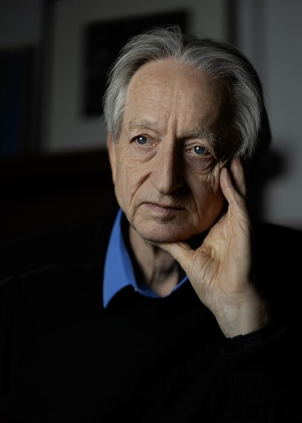</a>
    <figcaption style="font-size:0.36em;opacity:.85;margin:0.1em 0 0 0;line-height:1;">Hinton</figcaption>
  </figure>
  <figure style="margin:0; text-align:center;">
    <a href="http://yann.lecun.com/" target="_blank" rel="noopener" style="text-decoration:none;"></a>
    <figcaption style="font-size:0.36em;opacity:.85;margin:0.1em 0 0 0;line-height:1;">LeCun</figcaption>
  </figure>
  <figure style="margin:0; text-align:center;">
    <a href="https://yoshuabengio.org/" target="_blank" rel="noopener" style="text-decoration:none;">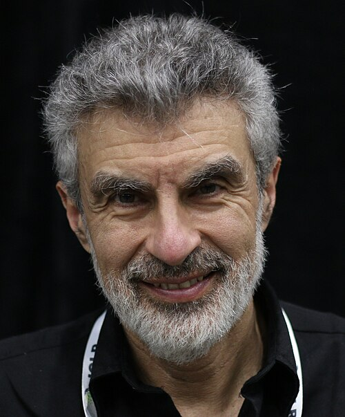</a>
    <figcaption style="font-size:0.36em;opacity:.85;margin:0.1em 0 0 0;line-height:1;">Bengio</figcaption>
  </figure>
  <figure style="margin:0; text-align:center;">
    <a href="https://people.idsia.ch/~juergen/" target="_blank" rel="noopener" style="text-decoration:none;">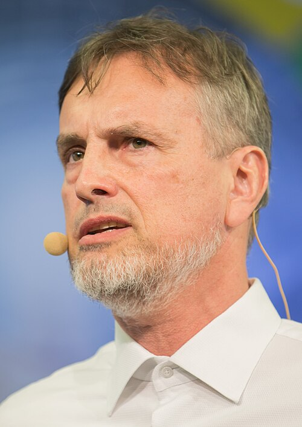</a>
    <figcaption style="font-size:0.36em;opacity:.85;margin:0.1em 0 0 0;line-height:1;">Schmidhuber</figcaption>
  </figure>

</div>
:::
::::

::: {.notes}
The tribe that won — for now. Point at the pulse for one beat before you start: each unit collects, sums, and fires forward — that is the whole biological neuron, and the 1943 model is a shameless cartoon of exactly it. The animation is a real forward pass: every pulse is a fresh input pushed through fixed weights, orange edges excite, blue ones inhibit, and the output unit that wins flares. Different input, different winner — that is computation, not decoration. Everything since is that cartoon, stacked into layers, which is what the 3D network is showing; the rotation is only there so you can see the depth. Inspiration is the brain: McCulloch–Pitts neurons in 1943, Rosenblatt's perceptron in 1958, then backpropagation in 1986 unlocked deep nets → CNNs → transformers. The engine is stochastic gradient descent. Why it dominates: it scales with data and compute, which is Sutton's bitter lesson made flesh. The capsid example: neural nets designing viral protein shells for gene therapy — learning the sequence-to-structure map no human could hand-code. This connects straight to the LLMs from Section IV.
:::

---

## Connectionists: Bolivarian Contribution

:::: {.columns}
::: {.column width="54%"}
- Two inspiring contributors from the Bolivarian nations!
:::
::: {.column width="46%"}
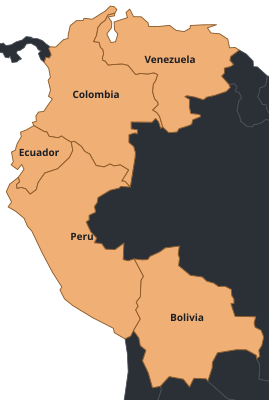{style="height:370px;"}
:::
::::

::: {.notes}
Personal / local-connection slide — a nod to the host country and its researchers. Fill in the two names and their contributions before the talk, and say a warm sentence about each; this is a moment to connect with the room, not to teach. Keep it short and generous, then move back to the tribes.

The five on the map are the Bolivarian nations — Venezuela, Colombia, Ecuador, Peru, Bolivia — the republics Bolívar liberated. Deliberately not "Gran Colombia," which was a different and shorter-lived thing (Colombia, Venezuela, Ecuador and Panama, 1819–1831). If someone raises it, that distinction is worth conceding cheerfully rather than defending.
:::

---

## Evolutionaries — Selection Algorithm

:::: {.columns}
::: {.column style="width:66%; font-size:0.74em;"}
- Roots: Darwin, formalized by Holland (1975)
- Evolve a population — mutation, crossover, selection
- No gradient, no labels — only a fitness score
- Optimization: genetic algorithms / evolutionary search
- Niche but creative: architecture search, robot morphology
- EXAMPLE: Avoiding immune response for gene envelope
:::
::: {.column width="34%"}
<div style="display:flex;flex-direction:column;align-items:center;gap:0.5em;">
  <figure style="margin:0;text-align:center;">
    <a href="https://en.wikipedia.org/wiki/John_Henry_Holland" target="_blank" rel="noopener" style="text-decoration:none;">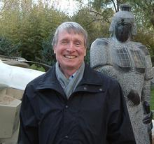</a>
    <figcaption style="font-size:0.32em;opacity:.55;margin:0.15em 0 0 0;line-height:1.2;">John H. Holland</figcaption>
  </figure>
  <figure style="margin:0;text-align:center;width:100%;">
    <canvas class="viz3d" data-scene="landscape" role="img" aria-label="Animated 3D fitness landscape with a population of orange dots climbing towards its peaks over successive generations; pale dots are elites carried over unchanged, and a white ring marks the best point found so far." style="width:100%;aspect-ratio:1/1;border-radius:8px;background:#1c1c1c;display:block;margin:0 auto;"></canvas>
    <figcaption style="font-size:0.3em;opacity:.55;margin:0.12em 0 0 0;line-height:1.2;">Selection on a fitness landscape — a population climbs, some get stuck</figcaption>
  </figure>
</div>
:::
::::

::: {.notes}
Darwin as algorithm, formalized by Holland in 1975. Use the 3D landscape: height is fitness, each dot is a candidate solution, and every generation the better half breed and mutate. Nobody told any of them where the peaks are — there is no label, no gradient, only a score for how high you happen to be standing. Keep the winners, mutate, repeat. The pale dots are the elites, carried into the next generation unchanged, and the white ring marks the best point found so far. Point out that some dots settle on a lower peak and stay there — that is the local-optimum problem, and why evolutionary search keeps a diverse population. That is the whole tribe in one loop, and it is also why it is slow. You keep a population of candidate solutions and apply mutation, crossover, and selection against a fitness score — no gradient, no labels, just "did it work better?" That makes it the tool of choice when the problem is non-differentiable or you can't even write down the objective: neural architecture search, evolving robot body shapes. The example ties back to the capsid: evolving a gene-therapy envelope that slips past the immune system, an objective too messy for gradients. Niche today, but genuinely creative.
:::

---

## Bayesians — Belief as Probability

:::: {.columns}
::: {.column style="width:74%; font-size:0.68em;"}
- Roots: Bayes (1763), Laplace
- Learning = updating a distribution over hypotheses
- Prior + likelihood → posterior
- Optimization: probabilistic inference (MCMC, variational inference)
- Calibrated uncertainty, at a computational cost
- EXAMPLE: Soldier Death Benefit Pensions
:::
::: {.column width="26%"}
[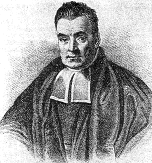{width="76%" style="border-radius:8px;"}](https://en.wikipedia.org/wiki/Bayes%27_theorem){target="_blank" rel="noopener"}
:::
::::

:::: {style="font-size:0.5em; margin-top:0.15em;"}
$$\underset{\color{#f0a868}{\text{posterior}}}{\color{#f0a868}{P(H \mid D)}} \;=\; \frac{\underset{\color{#63b3a6}{\text{likelihood}}}{\color{#63b3a6}{P(D \mid H)}}\;\cdot\;\underset{\color{#7aa0e0}{\text{prior}}}{\color{#7aa0e0}{P(H)}}}{\underset{\color{#9aa0aa}{\text{evidence}}}{\color{#9aa0aa}{P(D)}}}$$
::::

:::: {style="font-size:0.46em; margin-top:-0.3em;"}
$$\underset{\color{#e06c75}{\text{predictive}}}{\color{#e06c75}{P(x^{*} \mid D)}} \;=\; \int \color{#63b3a6}{P(x^{*} \mid H)}\; \color{#f0a868}{P(H \mid D)}\; dH \qquad \text{— average over every hypothesis, don't pick one}$$
::::

::: {.notes}
The tribe that takes uncertainty seriously. Roots in Bayes (1763) and Laplace: learning is updating a probability distribution over hypotheses — prior plus likelihood gives posterior. Inference is the hard part (MCMC, variational methods), and the payoff is calibrated uncertainty: the model tells you how sure it is, at real computational cost. The pension example is the point of the tribe — actuarial estimates of survivor benefits where being honestly uncertain matters more than a single confident guess, and a wrong point estimate has human consequences. Note LLMs borrow this for uncertainty estimates.
:::

---

## Analogizers — Similarity

:::: {.columns}
::: {.column style="width:66%; font-size:0.8em;"}
- Roots: psychology — reasoning from prior cases
- k-nearest neighbors, SVMs, the kernel trick
- Optimization: constrained optimization to maximize margin (SVMs)
- Legacy: recommendation, few-shot via embeddings
- EXAMPLE: Locating outperforming stock pairs
:::
::: {.column width="34%"}
<div style="display:flex; flex-direction:column; align-items:center; gap:0.45em;">
<div style="text-align:center; line-height:1;">
<a href="https://en.wikipedia.org/wiki/Vladimir_Vapnik" target="_blank" rel="noopener" style="text-decoration:none;">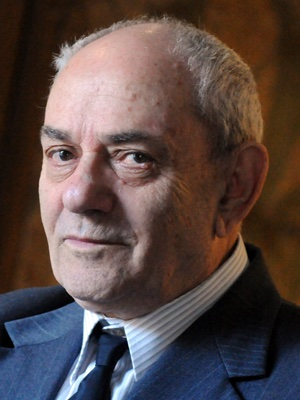</a>

</div>
<div style="font-size:0.32em;opacity:.55;line-height:1.2;text-align:center;">Vladimir Vapnik — co-inventor of the SVM</div>
<canvas class="viz3d" data-scene="kernel" role="img" aria-label="Animated 3D scene: tangled teal and orange points on a plane are lifted into three dimensions on thin stems, where a flat blue plane separates them." style="width:100%;aspect-ratio:1/1;border-radius:8px;background:#1c1c1c;display:block;margin:0 auto;"></canvas>
<div style="font-size:0.3em; opacity:.55; line-height:1.3; text-align:center;">The kernel trick — lift to a space where a flat plane separates them</div>
</div>
:::
::::

::: {.notes}
The fifth tribe: reason by similarity to past cases rather than by rules or models. Roots in psychology; the workhorses are k-nearest neighbours and SVMs, whose kernel trick measures similarity in high-dimensional space. The legacy is everywhere — recommendation systems ("people like you"), and few-shot learning via embeddings, which is how modern LLMs retrieve. The stock example: pairs trading, finding two stocks that historically move together and betting on the gap when they diverge — pure reasoning from analogous past behaviour. Set up the synthesis slide next: today's systems quietly use all five.

The flag is a callback to Dartmouth, and worth thirty seconds. Vapnik and Chervonenkis built statistical learning theory — VC dimension, the margin, eventually the SVM — in Moscow through the 1960s and 70s, at an institute for control sciences, under the disciplinary banner of *cybernetics*. That is the very word McCarthy picked "artificial intelligence" to avoid. So the same intellectual territory got two names on two sides of the Iron Curtain, and the Western half spent decades not reading the Eastern half: VC theory only really landed here after Vapnik came to Bell Labs around 1990. The point for the ambiguity thread: the name a field carries is an accident of politics, and it determines who reads you.

The animation shows the kernel trick, the tribe's other big idea. On the flat floor, teal sits inside an orange ring — no straight line separates them. Lift each point by its squared distance from the centre and a flat plane now cuts between the classes; projected back down, that plane is the circle. Say that the real trick is that kernels let you compute in the lifted space without ever building it. Then the margin: among all separating planes, the SVM picks the one that sits as far from both classes as possible. Say that the margin is not a detail, it is the whole theory: Vapnik's claim was that the widest gap is the one that generalises, and he had the proof, not just the intuition.
:::

---

## The Frontier Borrows From All Five

- No production system is one tribe
- LLMs: connectionist core, Bayesian uncertainty, symbolic tools, RL tuning
- Domingos' provocation: one master algorithm?
- Which synthesis will *your* work advance?

::: {.notes}
Section V landing, and the first direct address to the doctoral candidates. No real production system is a single tribe — a modern LLM is a connectionist core with Bayesian uncertainty, symbolic tool use bolted on, and RL for tuning. Domingos' provocation: is there one "master algorithm" that unifies all five? I don't claim there is. End on the question aimed straight at the room — which synthesis will your thesis push forward? Let it sit before the section break.
:::

---

## VI. State of the Art {.section-divider}

---

## Brittle AI & the Reasoning Gap

::: {style="font-size:0.84em;"}
- Narrow, brittle outside the training distribution
- The frontier problem is sample-efficient reasoning, not scale
- Performance can mask absent understanding
- ARC-AGI-3 **saturated** in a year — at thousands of dollars in compute
- The compute-capped ARC Prize is still unclaimed
:::

<div style="display:flex;justify-content:center;align-items:center;gap:1.2em;margin-top:0.1em;">
  <a href="https://arcprize.org/" target="_blank" rel="noopener" style="text-decoration:none;">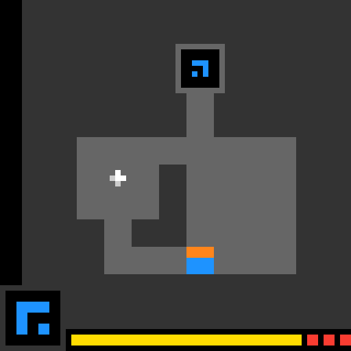</a>
  <a href="https://arcprize.org/leaderboard" target="_blank" rel="noopener" style="text-decoration:none;">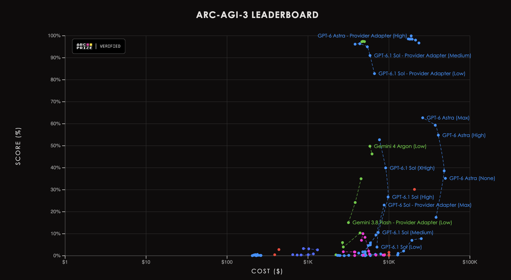</a>
</div>

::: {.notes}
Set the honest tone for Section VI — this is the reality check after the tribes. Today's systems are narrow and brittle the moment you step outside the training distribution. The reframe that matters: the frontier problem is reasoning, not scale — more parameters won't close this gap. And the warning to the researchers in the room: benchmark performance can mask a total absence of understanding, so measure carefully and distrust a single headline number. The animation is an ARC-AGI puzzle being solved — gesture at it when you name the reasoning gap: a child infers the rule from two or three examples, for free, and that sample-efficiency is the thing being measured. Then point at the leaderboard, and be honest about what it now shows: ARC-AGI-3 launched billed by the ARC Prize Foundation as "the world's only unbeaten benchmark" and the frontier systems have since pushed it to the ceiling — the top entries sit at or near 100%. The two things to make the room see are the axes: the score axis had to be redrawn from 20% to 100% in under a year, and the cost axis is logarithmic — those top scores cost thousands of dollars in compute, and the cheap end of the chart is still flat on zero. So the reframe survives the saturation: the benchmark fell to scale and spend, not to sample-efficient reasoning, which is exactly Chollet's distinction from Section III. Say plainly that a benchmark saturating is not the same as the problem being solved — this is the "performance masks understanding" bullet made concrete, and a warning that any benchmark you build will be chased down fast. The last bullet is the stakes: the ARC Prize is for an open-source solution under a hard compute cap, and that is what remains unclaimed — the standing bounty is for efficiency, not for a frontier model with an unlimited budget.
:::

---

## System 1 vs. System 2

:::: {.columns}
::: {.column style="width:56%; font-size:0.86em;"}
- After Kahneman: fast intuition, slow deliberation
- **System 1** — crystallized knowledge: answers in one fast pass of **inference**
- **System 2** — **learning**: slow, effortful, grows what isn't there yet
- Practice turns System 2 into System 1
- LLMs: a vast crystal, frozen after training — "reasoning" isn't yet learning
:::
::: {.column width="44%"}
<div style="display:flex;flex-direction:column;align-items:center;gap:0.3em;">
<a href="https://en.wikipedia.org/wiki/Daniel_Kahneman" target="_blank" rel="noopener" style="text-decoration:none;display:flex;align-items:center;gap:0.5em;">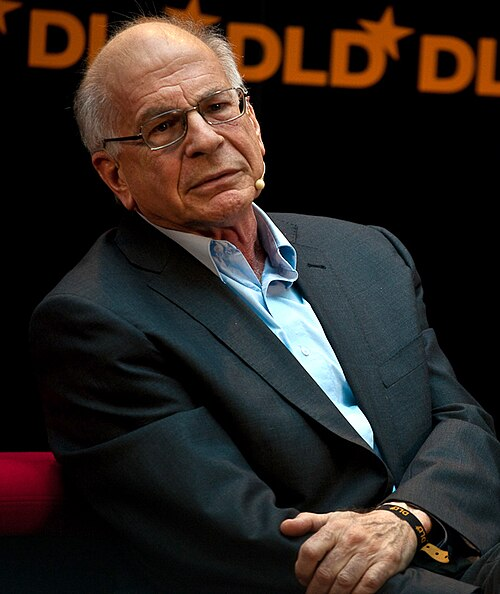<span style="font-size:0.32em;opacity:.55;color:#e3e6ec;">Daniel Kahneman</span></a>
<div style="width:100%;"><canvas class="viz3d" data-scene="crystal" role="img" aria-label="Animated 3D crystal lattice. Orange sparks shoot straight through it in a fraction of a second. A white spark arrives where the crystal does not reach and waits while new teal cells slowly grow out to meet it; once connected, it too passes through in a flash." style="width:100%;aspect-ratio:16/11;border-radius:8px;background:#1c1c1c;display:block;"></canvas></div>
<div style="font-size:0.3em;opacity:.55;line-height:1.3;text-align:center;">Familiar questions flash through the crystal; a new one makes it grow</div>
</div>
:::
::::

::: {.notes}
Kahneman's two systems, given a deliberate twist — say out loud that it is a twist, because his System 2 is slow deliberate *reasoning*, and I am going to make it about *learning*. The word "crystallized" is borrowed from Cattell's crystallized versus fluid intelligence. This is also the payoff of the "System 1 at planetary scale" line from Section IV.

Narrate the animation; it runs on a fifteen-second loop and restarts when you arrive on the slide. The orange sparks are System 1: a familiar question goes in one side and the answer comes out the other in a single pass — that is inference, and it is fast because the knowledge is already crystallized. Then the white spark arrives somewhere the crystal does not reach. Nothing to recall. Watch it wait while teal cells slowly grow out to meet it — that is System 2, learning: slow, effortful, and it changes the structure. And then the payoff: the same question now flashes through in orange. That is the fourth bullet — practice turns System 2 into System 1. Learning to drive is the example everyone has lived: effortful for weeks, then automatic.

Land the last bullet carefully. An LLM's crystal was grown in one enormous System 2 phase called training, and then frozen. "Reasoning" models think longer at inference time, which is real progress, but the weights don't change — and in-context learning evaporates when the conversation ends. So the line to land: intelligence is not the size of your crystal, it is how fast you can grow it. That is the sample-efficiency thread again. Flag that this area is moving fast — continual learning is an active research front.
:::

---

## Reality Gets a Vote

:::: {.columns}
::: {.column width="62%"}
- Knowledge is what survives a test
- Code and maths moved fastest — they can be **checked**
- Fluency with no verifier → hallucination
- Essays, strategy, taste, most real tasks: no oracle
:::
::: {.column width="38%"}
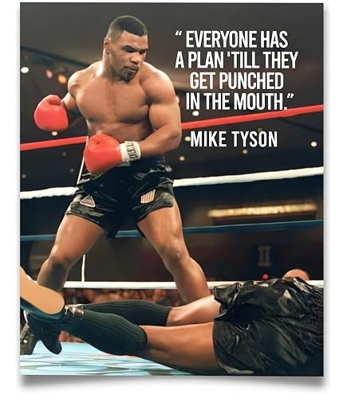
:::
::::

::: {.notes}
Define your sense of "grounding" out loud, because the word is overloaded. Philosophers use it for how symbols get their meaning — Harnad, the Chinese Room; that's Section I's question and I'm not asking it here. I mean the engineering sense: does anything check the answer? Note that this is the same move as Section III — name the ambiguity, pick a definition, hold to it. The line to land is the second bullet: a model trained only on text has never once been told it was wrong by the world. Tyson is the joke that buys you the point — let the room read it, then say it: a plan that has never met a punch is fluency, and the punch is the verifier. Use it once and move on; don't milk it.
:::

---

## Pearl's Ladder

:::: {.columns}
::: {.column width="62%"}
- **See** — P(y | x)
- **Do** — P(y | do(x))
- **Imagine** — what if I had?
- LLMs just see, no doing or imagining without a verifier!
- Can't watch your way to cause
:::
::: {.column width="38%"}
[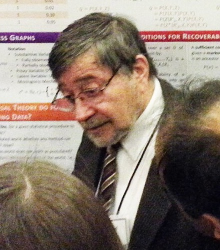{width="76%" style="border-radius:10px;"}](http://bayes.cs.ucla.edu/jp_home.html){target="_blank" rel="noopener"}
:::
::::

::: {.notes}
Pearl's *Book of Why* in one slide — don't derive anything. Three rungs: seeing is association, which is where all of statistics and machine learning lives; doing is intervention; imagining is counterfactual. Say the do-operator aloud once so it's not just notation. The punchline is the last bullet: everything we have praised tonight sits on rung one.

The photo is Pearl at NeurIPS, standing at his own poster — the notation behind his shoulder is the graphical-model machinery this slide is compressing. Worth one sentence if the room is warm.
:::


---

## The Experiment Is the Intervention

::: {style="font-size:0.84em;"}
- **do(x)** — reach in, *set* x by hand, cutting its usual causes
- That severed graph is what an experiment *is* — randomise, don't just watch
- **Verifying and causing are one move**
:::

```{=html}
<div style="display:flex;justify-content:center;align-items:center;gap:0.5em;margin-top:0.4em;">
<a href="https://en.wikipedia.org/wiki/Causal_inference" target="_blank" rel="noopener" style="text-decoration:none;flex:0 0 auto;"><svg id="garden-dag" viewBox="0 0 680 400" role="img" aria-label="Two causal diagrams that light up with each day of the garden. See: Season drives the Gardener, who sets the Sprinkler; Season also drives Rain; Sprinkler and Rain wet the grass; wet grass is slippery. Do, at random: Randomization sets the Sprinkler, and the arrow from Season is cut." style="height:270px;width:459px;display:block;" font-family="-apple-system, Helvetica, Arial, sans-serif"><defs><marker id="gdag-ah" markerWidth="9" markerHeight="9" refX="7" refY="3" orient="auto"><path d="M0,0 L7,3 L0,6 Z" fill="#9ab4dd"/></marker><marker id="gdag-aho" markerWidth="9" markerHeight="9" refX="7" refY="3" orient="auto"><path d="M0,0 L7,3 L0,6 Z" fill="#f0a868"/></marker></defs><g data-p="see"><text x="150" y="24" text-anchor="middle" fill="#9aa0aa" font-size="17" font-style="italic">See &#183; P(slippery | sprinkler)</text><g data-e="season-decider"><line x1="128.2" y1="79.3" x2="94.8" y2="111.9" stroke="#9ab4dd" stroke-width="2.6" marker-end="url(#gdag-ah)"/></g><g data-e="decider-sprinkler"><line x1="66.3" y1="162.0" x2="64.1" y2="192.0" stroke="#9ab4dd" stroke-width="2.6" marker-end="url(#gdag-ah)"/></g><g data-e="season-rain"><line x1="165.4" y1="80.6" x2="221.4" y2="162.7" stroke="#9ab4dd" stroke-width="2.6" marker-end="url(#gdag-ah)"/></g><g data-e="sprinkler-wet"><line x1="88.6" y1="242.6" x2="117.5" y2="264.9" stroke="#9ab4dd" stroke-width="2.6" marker-end="url(#gdag-ah)"/></g><g data-e="rain-wet"><line x1="220.8" y1="211.4" x2="174.7" y2="262.6" stroke="#9ab4dd" stroke-width="2.6" marker-end="url(#gdag-ah)"/></g><g data-e="wet-slip"><line x1="150.0" y1="315.0" x2="150.0" y2="333.0" stroke="#9ab4dd" stroke-width="2.6" marker-end="url(#gdag-ah)"/></g><g data-n="season"><ellipse cx="150" cy="58" rx="48" ry="21" fill="#3f6aa0" stroke="#7aa0e0" stroke-width="1.5"/><text x="150" y="63" fill="#fff" font-size="15" text-anchor="middle">Season</text></g><g data-n="rain"><ellipse cx="240" cy="190" rx="42" ry="21" fill="#3f6aa0" stroke="#7aa0e0" stroke-width="1.5"/><text x="240" y="195" fill="#fff" font-size="15" text-anchor="middle">Rain</text></g><g data-n="sprinkler"><ellipse cx="62" cy="222" rx="54" ry="21" fill="#3f6aa0" stroke="#7aa0e0" stroke-width="1.5"/><text x="62" y="227" fill="#fff" font-size="15" text-anchor="middle">Sprinkler</text></g><g data-n="wet"><ellipse cx="150" cy="290" rx="56" ry="22" fill="#3f6aa0" stroke="#7aa0e0" stroke-width="1.5"/><text x="150" y="295" fill="#fff" font-size="15" text-anchor="middle">Grass wet</text></g><g data-n="slip"><ellipse cx="150" cy="364" rx="66" ry="22" fill="#3f6aa0" stroke="#7aa0e0" stroke-width="1.5"/><text x="150" y="369" fill="#fff" font-size="14" text-anchor="middle">Grass slippery</text></g><g data-n="decider"><ellipse cx="68" cy="138" rx="62" ry="21" fill="#3f6aa0" stroke="#7aa0e0" stroke-width="1.5"/><text x="68" y="143" fill="#fff" font-size="15" text-anchor="middle">Gardener</text></g></g><line x1="340" y1="12" x2="340" y2="388" stroke="#3a3f47" stroke-width="1.5" stroke-dasharray="4 5"/><g data-p="do" transform="translate(340,0)"><text x="150" y="24" text-anchor="middle" fill="#f0a868" font-size="17" font-style="italic">Do, at random &#183; P(slippery | do(sprinkler))</text><g stroke="#e06c75" stroke-width="2.2" opacity="0.6" stroke-dasharray="5 4"><line x1="128.2" y1="79.3" x2="115.0" y2="92.1"/><line x1="103.7" y1="103.2" x2="90.5" y2="116.1"/></g><text x="109.3" y="103.7" text-anchor="middle" fill="#e06c75" font-size="17" font-weight="bold">&#10005;</text><g data-e="decider-sprinkler"><line x1="66.3" y1="162.0" x2="64.1" y2="192.0" stroke="#f0a868" stroke-width="2.6" marker-end="url(#gdag-aho)"/></g><g data-e="season-rain"><line x1="165.4" y1="80.6" x2="221.4" y2="162.7" stroke="#9ab4dd" stroke-width="2.6" marker-end="url(#gdag-ah)"/></g><g data-e="sprinkler-wet"><line x1="88.6" y1="242.6" x2="117.5" y2="264.9" stroke="#9ab4dd" stroke-width="2.6" marker-end="url(#gdag-ah)"/></g><g data-e="rain-wet"><line x1="220.8" y1="211.4" x2="174.7" y2="262.6" stroke="#9ab4dd" stroke-width="2.6" marker-end="url(#gdag-ah)"/></g><g data-e="wet-slip"><line x1="150.0" y1="315.0" x2="150.0" y2="333.0" stroke="#9ab4dd" stroke-width="2.6" marker-end="url(#gdag-ah)"/></g><g data-n="season"><ellipse cx="150" cy="58" rx="48" ry="21" fill="#3f6aa0" stroke="#7aa0e0" stroke-width="1.5"/><text x="150" y="63" fill="#fff" font-size="15" text-anchor="middle">Season</text></g><g data-n="rain"><ellipse cx="240" cy="190" rx="42" ry="21" fill="#3f6aa0" stroke="#7aa0e0" stroke-width="1.5"/><text x="240" y="195" fill="#fff" font-size="15" text-anchor="middle">Rain</text></g><g data-n="sprinkler"><ellipse cx="62" cy="222" rx="54" ry="21" fill="#3f6aa0" stroke="#7aa0e0" stroke-width="1.5"/><text x="62" y="227" fill="#fff" font-size="15" text-anchor="middle">Sprinkler</text></g><g data-n="wet"><ellipse cx="150" cy="290" rx="56" ry="22" fill="#3f6aa0" stroke="#7aa0e0" stroke-width="1.5"/><text x="150" y="295" fill="#fff" font-size="15" text-anchor="middle">Grass wet</text></g><g data-n="slip"><ellipse cx="150" cy="364" rx="66" ry="22" fill="#3f6aa0" stroke="#7aa0e0" stroke-width="1.5"/><text x="150" y="369" fill="#fff" font-size="14" text-anchor="middle">Grass slippery</text></g><g data-n="decider"><ellipse cx="68" cy="138" rx="62" ry="21" fill="#f0a868" stroke="#f6c89a" stroke-width="1.5"/><text x="68" y="143" fill="#1a1a1a" font-size="14" text-anchor="middle" font-weight="700">Randomization</text></g></g></svg></a>
<div style="flex:0 1 620px;min-width:0;height:270px;"><canvas class="viz3d" data-scene="garden" data-dag="garden-dag" role="img" aria-label="Animated 3D garden in Mumbai, one real day at a time, beside a causal diagram that lights up with each day: the season, then the gardener&#8217;s decision and the rain, then wet grass, then slippery. The garden shows sun or monsoon cloud, the sprinkler, that day&#8217;s real rain, grass that darkens when wet, and a yellow caution sign when the grass is slippery. Each phase walks one year, a day from every month. First we see: a gardener decides by the season, watering most dry-season days and few monsoon days. Then we do, at random: randomization sets the sprinkler, whatever the season. A data table fills in, one tile per day, by sprinkler on or off and by dry season or monsoon. Seeing, the sprinkler&#8217;s on days are mostly dry-season days and its off days mostly monsoon days: slippery 100% versus 40%. With randomization, both rows get the same seasons: 100% versus 17%." style="width:100%;height:100%;border-radius:8px;background:#1c1c1c;display:block;"></canvas></div>
</div>
```

::: {.notes}
The unification. An experiment is literally an intervention — do(x) is what you are doing when you randomise. The diagram on the left now shows the mechanism that Pearl's single arrow hides: the season drives the *gardener*, the gardener sets the sprinkler, and the season also drives the rain; sprinkler and rain both wet the grass, and wet grass is slippery. On the See side, seeing the sprinkler on also tells you the gardener's reason — the season — and the season told the rain: the correlation is contaminated. On the Do side, randomization sets the sprinkler and the arrow from Season is cut, so nothing upstream explains it away, and what flows down to the wet — and slippery — grass is pure cause.

Then let the garden play — one real Mumbai day at a time — and the diagram lights up with it, in causal order: the season first, then the gardener's decision and the rain, then wet grass, then slippery. Name the mapping once: sun or monsoon cloud is Season, the spray is Sprinkler, the streaks are Rain, the darkening grass is Grass wet, the yellow sign and node are Grass slippery. The rain is real — what fell at Santacruz on each date in the caption, 1987–88 — but the gardener's choices and the random draws are made up. Each half walks one year, the 15th of every month, so the monsoon is a third of the days, as on the calendar. The loop runs about 42 seconds and restarts when you land on the slide. First we *see*. The captions say *so* when the gardener follows the season and *but* when they don't — that is the hidden mechanism in words. The moment to point at is 15 June: monsoon, the gardener skips, and 120 mm falls — Season lights up *both* the gardener's "off" and the rain. That fork is why seeing misleads. (15 September is worth a glance too: monsoon, the gardener skips again, but no rain — Rain is its own node, not the season.) The panel is the data table: every day drops a tile into its row, sprinkler on or off, and its column, dry or monsoon. Seeing, the sprinkler adds 60 points — but the on row is mostly dry days and the off row mostly monsoon days, so you are comparing seasons as much as sprinklers. Then the orange phase: *do*, at random — a random draw sets the sprinkler, blind to the sky, and on the diagram the cut arrow means the season can no longer reach it. Now both rows get the same seasons and the gap widens. Point at the do(off) row's dry column: dry grass, no sign — the days that seeing almost never showed you. Same city, same seasons; only who decides changed. Twenty-four days are noisy — randomization's +83 overshoots the true +76 — so don't defend the number; the next slides do it with thirty years.

Land the third bullet: the verifier from *Reality Gets a Vote* and the ladder we have just walked are the same idea seen twice — reality only answers when you act on it. Then click on: the next two slides are why randomization works — first what Bayes' rule says about it, then the three ways to the answer side by side.
:::

---

## What "Off" Tells You

:::: {style="font-size:0.5em; margin-top:0.05em;"}
$$\underset{\color{#f0a868}{\text{posterior}}}{\color{#f0a868}{P(\text{monsoon} \mid \text{off})}} \;=\; \frac{\underset{\color{#63b3a6}{\text{likelihood}}}{\color{#63b3a6}{P(\text{off} \mid \text{monsoon})}}\;\cdot\;\underset{\color{#7aa0e0}{\text{prior}}}{\color{#7aa0e0}{P(\text{monsoon})}}}{\underset{\color{#9aa0aa}{\text{evidence}}}{\color{#9aa0aa}{P(\text{off})}}}$$
::::

::: {.bayes}
```{=html}
<div class="bgrid">
<div></div><p class="who see">See <span>the gardener decides, by the season</span></p><p class="who do">Do <span>at random: randomization decides</span></p>
<div class="area">area = probability</div><svg viewBox="0 0 412 140" class="mosaic" role="img" aria-label="Mosaic, area is probability. See: the gardener decides. The columns are the seasons over the whole year: the dry season, October to May, is two thirds of the days, the monsoon, June to September, one third. The gardener switches the sprinkler off on a quarter of dry days and three quarters of monsoon days, so three fifths of the off area is monsoon. Rain falls on 3 percent of dry-season days and 67 percent of monsoon days."><text x="2.0" y="15" fill="#cfd4dc" font-size="13.5" font-weight="700">dry season <tspan fill="#7aa0e0">⅔</tspan></text><rect x="0.0" y="22.0" width="268.0" height="85.5" rx="3" fill="#2a2f37"/><text x="8.0" y="36.0" fill="#8b919a" font-size="13">on <tspan fill="#63b3a6">¾</tspan></text><rect x="0.0" y="111.5" width="268.0" height="28.5" rx="3" fill="#1d2127" stroke="#9ab4dd" stroke-width="2"/><rect x="1.0" y="137.8" width="266.0" height="1.2" fill="#f2cc3d" opacity="0.92"/><text x="8.0" y="125.5" fill="#fff" font-size="13" font-weight="700">off <tspan fill="#63b3a6">¼</tspan></text><text x="260.0" y="125.5" fill="#f2cc3d" font-size="13" text-anchor="end">rain 3%</text><text x="280.0" y="15" fill="#cfd4dc" font-size="13.5" font-weight="700">monsoon <tspan fill="#7aa0e0">⅓</tspan></text><rect x="278.0" y="22.0" width="134.0" height="28.5" rx="3" fill="#2a2f37"/><text x="286.0" y="36.0" fill="#8b919a" font-size="13">on <tspan fill="#63b3a6">¼</tspan></text><rect x="278.0" y="54.5" width="134.0" height="85.5" rx="3" fill="#1d2127" stroke="#9ab4dd" stroke-width="2"/><rect x="279.0" y="81.9" width="132.0" height="57.1" fill="#f2cc3d" opacity="0.92"/><text x="286.0" y="68.5" fill="#fff" font-size="13" font-weight="700">off <tspan fill="#63b3a6">¾</tspan></text><text x="345.0" y="115.5" fill="#1a1a1a" font-size="13" font-weight="700" text-anchor="middle">rain 67%</text></svg><svg viewBox="0 0 412 140" class="mosaic" role="img" aria-label="Mosaic, area is probability. Do, at random: randomization decides. The dry season is two thirds of the days, the monsoon one third. Randomization switches the sprinkler off on half the days in both, so one third of the off area is monsoon, the same as before looking. Rain falls on 3 percent of dry-season days and 67 percent of monsoon days."><text x="2.0" y="15" fill="#cfd4dc" font-size="13.5" font-weight="700">dry season <tspan fill="#7aa0e0">⅔</tspan></text><rect x="0.0" y="22.0" width="268.0" height="57.0" rx="3" fill="#2a2f37"/><text x="8.0" y="36.0" fill="#8b919a" font-size="13">on <tspan fill="#63b3a6">½</tspan></text><rect x="0.0" y="83.0" width="268.0" height="57.0" rx="3" fill="#1d2127" stroke="#f0a868" stroke-width="2"/><rect x="1.0" y="137.3" width="266.0" height="1.7" fill="#f2cc3d" opacity="0.92"/><text x="8.0" y="97.0" fill="#fff" font-size="13" font-weight="700">off <tspan fill="#63b3a6">½</tspan></text><text x="260.0" y="97.0" fill="#f2cc3d" font-size="13" text-anchor="end">rain 3%</text><text x="280.0" y="15" fill="#cfd4dc" font-size="13.5" font-weight="700">monsoon <tspan fill="#7aa0e0">⅓</tspan></text><rect x="278.0" y="22.0" width="134.0" height="57.0" rx="3" fill="#2a2f37"/><text x="286.0" y="36.0" fill="#8b919a" font-size="13">on <tspan fill="#63b3a6">½</tspan></text><rect x="278.0" y="83.0" width="134.0" height="57.0" rx="3" fill="#1d2127" stroke="#f0a868" stroke-width="2"/><rect x="279.0" y="100.9" width="132.0" height="38.1" fill="#f2cc3d" opacity="0.92"/><text x="286.0" y="97.0" fill="#fff" font-size="13" font-weight="700">off <tspan fill="#63b3a6">½</tspan></text><text x="345.0" y="125.0" fill="#1a1a1a" font-size="13" font-weight="700" text-anchor="middle">rain 67%</text></svg>
<div class="term pri fragment" data-fragment-index="0">prior <span>P(monsoon)</span></div><div class="cell fragment" data-fragment-index="0"><b>⅓</b> <i>Jun&ndash;Sep: 122 of 365 days</i></div><div class="cell fragment" data-fragment-index="0"><b>⅓</b> <i>the same calendar</i></div>
<div class="term lik fragment" data-fragment-index="1">likelihood <span>P(off | season)</span></div><div class="cell fragment" data-fragment-index="1"><b>¾</b> monsoon, <b>¼</b> dry <i>the gardener &middot; ratio 3</i></div><div class="cell fragment" data-fragment-index="1"><b>½</b> monsoon, <b>½</b> dry <i>randomized &middot; ratio 1</i></div>
<div class="term evi fragment" data-fragment-index="2">evidence <span>P(off)</span></div><div class="cell fragment" data-fragment-index="2">¾&middot;⅓ + ¼&middot;⅔ = <b>5&#8260;12</b> <i>&asymp; 42%</i></div><div class="cell fragment" data-fragment-index="2">P(do(off)) = ½&middot;⅓ + ½&middot;⅔ = <b>½</b></div>
<div class="term pos fragment" data-fragment-index="3">posterior <span>P(monsoon | off)</span></div><div class="cell fragment" data-fragment-index="3">¾&middot;⅓ &divide; 5&#8260;12 = <b>⅗</b> <i>&ldquo;off&rdquo; lifts ⅓ to ⅗</i></div><div class="cell fragment" data-fragment-index="3">½&middot;⅓ &divide; ½ = <b>⅓</b> <i>the prior again</i></div>
<div class="term sli fragment" data-fragment-index="4">so, slippery <span>P(slippery | off)</span></div><div class="cell fragment" data-fragment-index="4">⅗&middot;67% + ⅖&middot;3% = <b>41%</b></div><div class="cell fragment" data-fragment-index="4">P(slippery | do(off)) = ⅓&middot;67% + ⅔&middot;3% = <b>24%</b></div>
</div>
```
:::

::: {.fragment style="font-size:0.72em;margin-top:0.2em;"}
- Inside each season the panels agree; only the **weights**, P(season | off), differ
- Randomization's likelihood ratio is 1: **posterior = prior**, even for unrecorded causes
:::

::: {.notes}
The engine under the garden, in the Bayes' rule we met with the Bayesians — same colours on purpose: each row under the mosaics is one term of the formula, coloured to match. Ask the room one question: you walk past and see the sprinkler off; what have you just learned about the season? Read the See mosaic first, where every rectangle's area is a probability: the widths are the seasons over the whole year, the heights are the gardener's habit, and the outlined cells are the off days. Then click through the rows, one term per click, See on the left and Do on the right. *Prior*, P(monsoon): a third on both sides, straight off the calendar — June to September is 122 of 365 days. *Likelihood*, P(off | season): this is where they part. The gardener switches off on three-quarters of monsoon days and a quarter of dry ones — the hidden mechanism from the last slide, in numbers — and that ratio of 3 is how much "off" says about the season. Randomization switches off on half the days whatever the season: ratio one, it says nothing. *Evidence*, P(off): every way of getting "off", added up — the outlined area. Five-twelfths for the gardener; for randomization, P(do(off)) is simply a half. *Posterior*, P(monsoon | off): the monsoon's share of that outlined area. The gardener's "off" lifts a third to three-fifths — Bayes' rule done with rectangles; a random "off" leaves it at a third, the prior again.

The last row is the law of total probability — the same "average over the hypotheses" as the Bayesians slide, with the seasons as the hypotheses and the posterior as the weights. Monsoon days come with rain, the yellow, so 41% of the gardener's off days are slippery for reasons that have nothing to do with the sprinkler; when randomization sets it — written do(off) for that reason — it is 24%, a fair sample of the weather. Click, and land the two lines. First: inside each column the yellow share is identical in both mosaics — 3% and 67% — so seeing and doing agree about every season; they disagree only about the weights. That is why recording the season works. Second, the one to land: a random "off" tells you nothing about the season — or about anything else, including the causes nobody wrote down. That is what randomization buys. If someone asks about April or October: they are in — the dry season here is all eight months outside the monsoon, which is why it rains on 3% of its days, not none. Then click on for the three ways side by side.
:::

---

## Why Randomization Works

::: {.whyrand}
:::: {.columns}
::: {.column width="48%"}
```{=html}
<p class="lede">Every Mumbai day, 1961–90: the true rates</p>
<table>
<thead><tr><th></th><th>dry season<span>Oct–May</span></th><th>monsoon<span>Jun–Sep</span></th></tr></thead>
<tbody>
<tr class="src"><td>share of the year <span>calendar</span></td><td>&frac23;</td><td>&frac13;</td></tr>
<tr class="src"><td>it rains <span>real record</span></td><td>3%</td><td>67%</td></tr>
<tr class="src"><td>gardener waters <span>assumed</span></td><td>75%</td><td>25%</td></tr>
<tr><td>slippery if sprinkler on</td><td>100%</td><td>100%</td></tr>
<tr><td>slippery if off</td><td>3%</td><td>67%</td></tr>
<tr class="eff"><td>sprinkler&#8217;s effect</td><td>+97 pts</td><td>+33 pts</td></tr>
</tbody>
</table>
```
:::
::: {.column width="52%"}
```{=html}
<div class="way see fragment"><p class="t">See <span>season not recorded</span></p><p>P(monsoon | off) = &frac35;, by Bayes</p><p class="calc">100% &minus; 41% = <b>+59 pts</b> <span class="no">&#10007;</span></p><p class="why">thirty years of data didn&#8217;t fix it</p></div>
<div class="way adj fragment"><p class="t">See + record the season <span>adjust</span></p><p>compare inside each season, weight by its share</p><p class="calc">&frac23;&middot;97 + &frac13;&middot;33 = <b>+76 pts</b> <span class="ok">&#10003;</span></p><p class="why">only for causes you knew to record</p></div>
<div class="way do fragment"><p class="t">Do <span>at random</span></p><p>P(monsoon | do(off)) = &frac13;, the prior</p><p class="calc">100% &minus; 24% = <b>+76 pts</b> <span class="ok">&#10003;</span></p><p class="why">balances causes nobody recorded</p></div>
```
:::
::::
```{=html}
<p class="formula fragment">see &nbsp;&sum;<sub>s</sub> P(y | x, s) &middot; <b class="b">P(s | x)</b> &emsp;&emsp; do &nbsp;&sum;<sub>s</sub> P(y | x, s) &middot; <b class="o">P(s)</b> &emsp;&emsp; <span>seeing weights by the posterior, doing by the prior</span></p>
```
:::

::: {.fragment style="font-size:0.72em;margin-top:0.15em;"}
- **Adjusting** fixes the confounders you know; **randomization** fixes them all
- To do experiments and find cause, you need a body
:::

::: {.notes}
The synthesis — the Bayes slide showed the mechanism; this puts the three ways to the answer side by side. Every number here comes from thirty years of real Mumbai rain (NOAA's Santacruz station, 1961–90, a rain day being at least a millimetre), so these are probabilities, not a sample — the noise of the twenty-four days is gone, which is the point. The whole year is in: the dry season is every month outside the monsoon, October to May, two-thirds of the days, and it rains on 3% of them — mostly October and November, the monsoon's tail. The only made-up row is the gardener's habit, and the only assumption is that wet grass is slippery.

Walk the table first. Inside a season, the sprinkler's effect never changes: in the dry season it is nearly the only water there is, +97; in the monsoon it mostly adds to rain that was coming anyway, +33. Then one click per card. *See*: Bayes said the gardener's off days are three-fifths monsoon, though the monsoon is only a third of the year, so they look slippery anyway and the sprinkler seems worth only +59. Stress that thirty years of data did not fix that — more data shrinks noise, not bias. *See, and record the season*: now you can fix it on paper — compare inside each season, then weight by how common each season is, two-thirds and a third: +76. That is Pearl's adjustment formula, and it works — but only for the confounders you knew to write down. *Do, at random*: +76 without knowing anything about seasons. A random draw cannot see the sky, so on days and off days get the same mix of seasons — and of every other cause nobody thought to record.

The formula line is the last slide in one row: seeing weights each season by the posterior P(s | x), doing by the prior P(s); randomization makes them equal, adjustment swaps them by hand. If someone asks why not just set the sprinkler by hand: you can, but if you choose by looking at the sky you are just a second gardener — randomization is what guarantees the choice is blind. Then land the last bullet slowly; it is the hinge of the back half — you cannot randomize what you cannot reach. That is why Section VIII turns to bodies.
:::

---

## VII. What We Want from AGI {.section-divider}

---

## Generality, Efficiency, Reasoning

- **Generality** — competence transfers to the untrained
- **Sample Efficiency** — human-like, from few examples
- **Robust Reasoning** — multi-step, causal, self-correcting

::: {.notes}
First three requirements. Generality means competence transfers to tasks it was never trained on — the opposite of the brittleness in Section VI. Sample efficiency is the spine's yardstick again: human-like learning from a handful of examples, not millions. Robust reasoning is multi-step, causal, and self-correcting — the System 2 the models still lack. Point out each one is a direct answer to a gap named earlier; this isn't a wish-list from nowhere.
:::

---

## Memory, Grounding, Aligned Autonomy

- **Persistent Memory** — no catastrophic forgetting
- **Grounded World Models** — causal, ideally embodied
- **Autonomy + Alignment** — open-ended yet controllable
- The last is a constraint — and the highest-stakes one

::: {.notes}
The remaining three, and slow down on the last. Persistent memory means no catastrophic forgetting — the missing piece from "The LLM." Grounded world models means causal, ideally embodied understanding, which sets up Section VIII. Then the crucial asymmetry: alignment isn't another capability, it's a constraint on all the others — we want open-ended autonomy that stays controllable. It's the only item where getting it wrong is catastrophic rather than merely disappointing, which is why it carries the most weight.
:::

---


## VIII. The Future {.section-divider}

---

## Foundation Models Meet Robotics

:::: {.columns}
::: {.column width="58%"}
- Model "brains" in capable "bodies"
- Surgery, deep-sea exploration, autonomous logistics
- The loop closes: sense → predict → act → learn
- Where the next decade concentrates
:::
::: {.column width="42%"}
<a href="https://www.unitree.com/g1" target="_blank" rel="noopener" style="text-decoration:none;">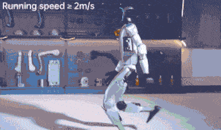</a>

<div style="font-size:0.3em;opacity:.55;line-height:1.2;text-align:center;margin-top:0.3em;">Unitree G1 — a body waiting for a better brain</div>
:::
::::

::: {.notes}
This is where I place my bet on the next decade. Let the robot loop — it is a Unitree G1, a genuinely capable body you can buy today, and it is the point of the whole slide: the hardware has arrived, the brain has not. Sensorimotor competence is nearly solved; what it lacks is the grounded, causal world-model from Section VI. That gap is the bet. Put the foundation-model "brain" into a capable "body" — surgery, deep-sea and space exploration, autonomous logistics. The unifying idea is the closed loop: sense, predict, act, learn — which is Friston's active inference and the RL loop from Section II, now running in the physical world. Tell the candidates plainly: this is where I'd concentrate, the convergence of foundation models and robotics. But hold it lightly — a bet, not a prophecy.
:::

---

## AI Ethics — Beyond My Expertise

- **Cheap Dopamine** — engineered attention capture
- **Economic Effects** — labour, wealth concentration
- **Children** — growing up AI-saturated
- **Distribution** — who reaps the fruits of the technology
- A prior, held lightly: fewer regulations tend to serve better

::: {.notes}
Handle with humility — say out loud that this is outside my expertise, because it is, and the honesty matters more than coverage. Name the stakes without pretending to resolve them: engineered attention capture ("cheap dopamine"), labour disruption and wealth concentration, children growing up AI-saturated, and who actually captures the benefits. The regulation line is a personal prior, explicitly held lightly — flag it as a view to argue with, not a conclusion, and invite disagreement in the discussion. Don't linger or preach.
:::

---

## Key Takeaways

- "AI" is an ambiguous term — today it means LLMs
- Minds run on prediction — octopus to cortex to transformer
- Human intelligence is the ML task list, written first in our biology
- The open gaps — reasoning, memory, grounding, alignment — are the agenda

::: {.notes}
The recap — tie the spine threads together one last time so they leave with them. "AI" is ambiguous and today means LLMs; minds run on prediction, from octopus to cortex to transformer; human intelligence is the ML task list written first in biology. Then land the fourth bullet as the handoff: the open gaps aren't failures of the field, they're the research agenda — reasoning, memory, grounding, alignment. Slow down; this is the last content slide — let the fourth bullet be the closing line, then click once to the Thank You slide and open the floor there.
:::

---

## Thank You {.section-divider}

**Questions?**

[project-delphi.github.io/ai-past-present-future-talk](https://project-delphi.github.io/ai-past-present-future-talk/){style="font-size:0.5em;opacity:0.7;"}

::: {.notes}
This is where you thank people and open the floor — the only place; the Discussion slide at the very end is a fallback, not a second ending. Say thank you plainly — to the hosts, to the committee, and to the room for staying with a long argument — then ask for questions and wait; count to ten in silence if you have to, the first question is always the slowest. Leave this slide up through the questions: the link is there so anyone can find the deck, the references and the image credits afterwards. If the questions dry up early, jump to the Discussion slide for its prompt.
:::

---

## Key References I

*Foundations & cognition*

- Turing, A. (1950). Computing Machinery and Intelligence. *Mind*.
- Russell, S. & Norvig, P. (2020). *Artificial Intelligence: A Modern Approach* (4th ed.)
- Kahneman, D. (2011). *Thinking, Fast and Slow*.
- Friston, K. (2010). The free-energy principle: a unified brain theory? *Nature Reviews Neuroscience*.
- Murray, J. et al. (2014). A hierarchy of intrinsic timescales across primate cortex. *Nature Neuroscience*.
- Northoff, G. & Huang, Z. (2017). How do the brain's time and space mediate consciousness and its different dimensions? *Neurosci. Biobehav. Rev.*

---

## Key References II

*Symbolic & neural roots*

- Newell, A. & Simon, H. (1976). Computer science as empirical inquiry: symbols and search. *CACM*.
- McCulloch, W. & Pitts, W. (1943). A logical calculus of ideas immanent in nervous activity.
- Rosenblatt, F. (1958). The perceptron. *Psychological Review*.
- Minsky, M. & Papert, S. (1969). *Perceptrons*.

---

## Key References III

*Learning at scale*

- Rumelhart, D., Hinton, G. & Williams, R. (1986). Learning representations by back-propagating errors. *Nature*.
- Vaswani, A. et al. (2017). Attention Is All You Need. *NeurIPS*.
- Hinton, G., Bengio, Y. & LeCun, Y. — 2018 ACM A.M. Turing Award, for deep neural networks
- Dean, J. et al. (2012). Large scale distributed deep networks. *NeurIPS*.

---

## Key References IV

*Defining intelligence*

- Holland, J. (1975). *Adaptation in Natural and Artificial Systems*.
- Sutton, R. (2019). *The Bitter Lesson*.
- Chollet, F. (2019). On the measure of intelligence. *arXiv:1911.01547*.
- Domingos, P. (2015). *The Master Algorithm*.

---

## Key References V

*Causality & data*

- Pearl, J. & Mackenzie, D. (2018). *The Book of Why*.
- Menne, M. et al. (2012). Global Historical Climatology Network – Daily (GHCN-Daily), v3. NOAA NCEI. Station IN012070800, Bombay/Santacruz.

---

## Image Credits

:::: {.columns}
::: {.column style="width:50%; font-size:0.42em; opacity:0.75; line-height:1.32;"}
- Bonobo — natataek, CC BY-SA 3.0
- Octopus — Diego Delso, CC BY-SA 4.0
- L. Messi goal clip (Getafe, 2007) — broadcast footage, rights holder unidentified
- Mirror self-recognition (bear, infant, child animations) — via Medium
- G. Hinton — Cmichel67, CC BY-SA 4.0
- Y. LeCun — J. Barande, CC BY-SA 2.0
- Y. Bengio — Xuthoria, CC BY-SA 4.0
- J. Schmidhuber — ITU/R. Farrell, CC BY 2.0
- D. Kahneman — nrkbeta, CC BY-SA 2.0
- J. Pearl — Better Than Bacon, CC BY 2.0
- J. McCarthy — null0, CC BY-SA 2.0
- M. Minsky — OLPC, CC BY 3.0
- C. Shannon — Tekniska museet, CC BY 2.0
- F. Chollet — Ramosset, CC BY-SA 4.0
- A. Turing — Elliott & Fry, public domain
- T. Bayes — public domain (attribution disputed)
- Soviet flag — public domain
- Sensory homunculus — OpenStax College (derivative: Popadius), CC BY 3.0
- 3D visuals — three.js (mrdoob and contributors), MIT
- Early human migrations map — Dbachmann, CC BY-SA 4.0
- Acheulean handaxe (Saint-Acheul) — Didier Descouens, CC BY-SA 4.0
:::
::: {.column style="width:50%; font-size:0.42em; opacity:0.75; line-height:1.32;"}
- Map boundaries — Natural Earth, public domain
- J. Holland, V. Vapnik, J. Tenenbaum, K. Friston — no free licence identified; used under fair dealing for education
- Portrait with sculpture — personal photograph, used with permission
- Attention animation — BertViz, via comet.com
- Diffusion denoising animation — via Towards Data Science
- Decision tree animation — via Medium
- ANI/AGI/ASI illustration — via Medium
- AI history timeline — via LinkedIn
- Unitree G1 robot animation — via roboticgizmos.com
- Coffee-making robot animation — via Mothership
- ARC-AGI task animation & ARC-AGI-3 leaderboard — © ARC Prize Foundation, via arcprize.org
- M. Tyson quote poster — rights holder unidentified; used under fair dealing for education
:::
::::

::: {style="font-size:0.4em; opacity:0.6; margin-top:0.6em;"}
Photographs from Wikimedia Commons unless noted. Titled slide image: Piedras del Tunjo.
:::

::: {.notes}
Back-matter — don't present this, just let it exist. It's here so the CC BY and CC BY-SA images are properly attributed without cluttering the slides they appear on, which is the normal convention for a talk. The last line is the honest one: three portraits have no freely-licensed photograph in existence, and they're used under an educational rationale. If that ever becomes a problem, those three are the ones to pull.
:::

---

## Discussion

*What is the most important open problem in AI — and how will you spend the next five years on it?*

::: {.notes}
Fallback only — you have already thanked the room and opened the floor on the Thank You slide, so don't do either again here. Jump here if the questions dry up early: the prompt is deliberately personal and forward-looking, to pull answers from the candidates rather than abstract debate. Have two or three seed questions ready, and be willing to say "I don't know" — modelling intellectual honesty is the whole point of the evening.
:::
